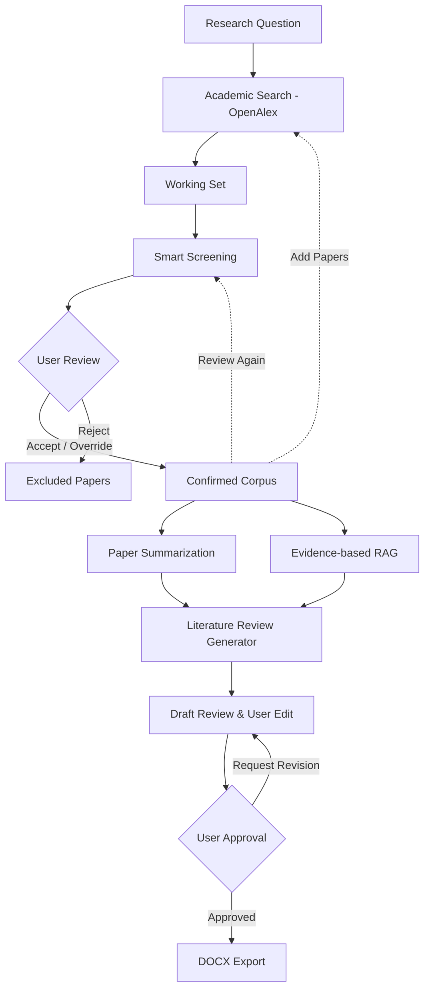

# Project Brief: LitReview Agent

## 1. Project Overview

| Item | Description |
|---|---|
| Project | LitReview Agent |
| Code | EDU-09 |
| Domain | AI Nghiên cứu |
| Timeline | 5 tuần |
| Product | Web application tích hợp AI hỗ trợ Literature Review |
| Status | Gate 1 – Chốt đề tài, bài toán và thiết kế |

LitReview Agent hỗ trợ người nghiên cứu tìm kiếm, sàng lọc, tóm tắt bài báo, hỏi đáp dựa trên bằng chứng và tạo bản nháp tổng quan nghiên cứu.

Hai nguyên tắc xuyên suốt:

- **Human-in-the-Loop (HITL):** Người dùng kiểm tra, chỉnh sửa, ghi đè và phê duyệt kết quả AI.
- **Evidence-based:** Nội dung phải có nguồn và bằng chứng truy xuất được; khi thiếu căn cứ, hệ thống phải thông báo thay vì suy diễn.

## 2. Problem Statement

Literature Review yêu cầu tìm kiếm, đọc, sàng lọc, đối chiếu và tổng hợp nhiều công trình. Quy trình hiện tại tốn thời gian, dữ liệu phân tán và khó kiểm chứng. Các công cụ AI giúp đọc/viết nhanh hơn nhưng có thể tạo thông tin thiếu căn cứ, citation sai hoặc kết luận không phản ánh nguồn.

LitReview Agent thống nhất quy trình xử lý tài liệu: AI hỗ trợ tìm kiếm, phân tích và tổng hợp; người dùng quyết định tài liệu được chọn và nội dung đầu ra.

## 3. Target Users & Pain Points

| Target Users | Vai trò | Pain Points |
|---|---|---|
| Sinh viên đại học nghiên cứu khoa học | Chính | Tốn thời gian tìm kiếm, sàng lọc tài liệu phù hợp Research Question |
| Học viên cao học | Chính | Khó tổng hợp nghiên cứu, lập bảng so sánh và kiểm chứng citation |
| Nhà nghiên cứu | Mở rộng | Cần rà soát hiệu quả nhưng vẫn kiểm chứng được nguồn |
| Giảng viên hướng dẫn | Phụ | Cần xem xét bản nháp và độ chính xác của nội dung, citation |

Quy trình hiện phân tán giữa công cụ tìm kiếm, ghi chú, soạn thảo và quản lý citation, làm tăng thời gian xử lý và nguy cơ sai lệch.

## 4. Proposed Solution

Paper Summarization và Evidence-based RAG là hai nhánh độc lập sau Confirmed Corpus, cùng cung cấp dữ liệu cho Literature Review Generator. Người dùng không cần hỏi RAG trước khi tạo bản tổng quan.

Người dùng có thể quay lại tìm kiếm/sàng lọc để thay đổi corpus. Khi corpus thay đổi, các kết quả phụ thuộc phải được đánh dấu cần cập nhật và phê duyệt cũ không còn áp dụng cho corpus mới. Người dùng luôn quyết định tài liệu, nội dung chỉnh sửa và việc phê duyệt trước khi xuất.

## 5. Core MVP Features

MVP gồm **5 tính năng**; HITL và Evidence-based là nguyên tắc thiết kế.

### 5.1. Academic Search

Tìm bài báo qua OpenAlex, hiển thị metadata, abstract, DOI và thông tin thư mục; người dùng chọn bài vào Working Set.

- `metadata_only`: Không có abstract.
- `abstract`: Có abstract.

### 5.2. Smart Screening

AI đánh giá mức độ liên quan với Research Question dựa trên metadata/abstract và nêu lý do.

`ai_classification`: `Relevant`, `Partially Relevant`, `Not Relevant`, `Insufficient Evidence`.

`review_status`: `Pending Review`, `Accepted`, `Rejected`, `Overridden`.

Quy tắc:

- Lưu độc lập `ai_classification`, không ghi đè.
- `Accepted`: `final_classification = ai_classification`.
- `Overridden`: người dùng chọn `final_classification`; lưu `override_note` nếu có.
- Chỉ `Accepted`/`Overridden` với phân loại `Relevant`/`Partially Relevant` mới vào Confirmed Corpus.
- `Insufficient Evidence` có thể giữ để xem xét nhưng vẫn `Pending Review`; không tự động vào corpus.
- Hệ thống không tự động loại hoặc thêm bài khi chưa có quyết định phù hợp của người dùng.

### 5.3. Paper Summarization

AI tạo tóm tắt 5 trường: **Research Objective, Methodology, Dataset, Results, Limitations**.

Chỉ sử dụng metadata và abstract hiện có, ghi nguồn cho từng trường. Trường thiếu thông tin hiển thị **“Không đề cập trong nguồn hiện có”** (*Not mentioned in available source*). MVP không xử lý hoặc tuyên bố đã phân tích toàn văn PDF khi chỉ có metadata/abstract.

### 5.4. Evidence-based RAG

Người dùng hỏi trên Confirmed Corpus; hệ thống truy xuất metadata/abstract và trả lời kèm citation, evidence.

Evidence Chunk phải là nội dung trích xuất nguyên văn từ abstract hoặc nguồn văn bản hợp lệ, gắn với `paper_id`, `source_type`, nội dung và vị trí nếu có; không được tạo đoạn văn giả lập.

Trạng thái trả lời:

- `sufficient_evidence`: Đủ bằng chứng.
- `insufficient_evidence`: Có thông tin liên quan nhưng chưa đủ căn cứ.
- `no_matching_evidence`: Không có bằng chứng phù hợp.

Khi thiếu bằng chứng, hệ thống từ chối kết luận thiếu căn cứ. Citation chỉ có metadata chỉ dùng để nhận diện bài báo, không chứng minh methodology, dataset hoặc findings.

### 5.5. Literature Review Generator

Tạo **Comparison Matrix** và **Literature Review Synthesis** từ Confirmed Corpus, Paper Summary và Evidence Chunk. Generator tự truy xuất evidence từ corpus, không phụ thuộc vào việc đã hỏi RAG và không mặc định dùng toàn bộ câu trả lời RAG.

Nguyên tắc:

- Factual claims, tổng hợp và diễn giải phải có citation/evidence hỗ trợ.
- Research Gap chỉ nêu trong phạm vi corpus đã phân tích.
- Không tự tạo citation, DOI, kết quả hoặc luận điểm thiếu căn cứ.

Người dùng chỉnh sửa và phê duyệt trước khi xuất DOCX. Tài liệu gồm Research Question, Synthesis, Comparison Matrix, In-text Citations và References/Bibliography từ metadata hợp lệ. MVP chỉ dùng APA 7. Khi nội dung hoặc corpus thay đổi, phải cập nhật phê duyệt; chỉ phiên bản được duyệt theo corpus hiện tại mới được xuất.

## 6. Unique Value Proposition

1. **User-controlled workflow:** Người dùng review, chỉnh sửa và ghi đè kết quả AI.
2. **Evidence traceability:** Nội dung truy xuất được về tài liệu và bằng chứng nguồn.
3. **Data transparency:** Phân biệt metadata, abstract và full text; không giả định AI đã đọc phần chưa cung cấp.
4. **Approval before export:** Chỉ xuất báo cáo sau quyết định phê duyệt của người dùng.

## 7. Objectives & Success Metrics

Xây dựng và demo MVP trong **5 tuần với 4 thành viên**, từ Academic Search đến DOCX Export sau phê duyệt. MVP ưu tiên vận hành end-to-end và khả năng kiểm chứng; tính năng nâng cao theo PRD được xếp Should/Could hoặc ngoài phạm vi. Các chỉ số sau là **target**, chưa phải kết quả thực nghiệm.

| Metric | Target | Measurement |
|---|---:|---|
| Screening Macro-F1 | ≥ 0.80 | Macro-F1 của Relevant, Partially Relevant, Not Relevant so với nhãn người gán |
| Citation Traceability | 100% | Citation truy xuất được đến nguồn hợp lệ trong Confirmed Corpus |
| Citation-Evidence Support | ≥ 80% | Luận điểm được citation có evidence thực sự hỗ trợ, do người chấm |
| Summary Faithfulness | ≥ 80% | Trường tóm tắt phản ánh đúng nguồn, do người chấm |
| Structured Output Validity | ≥ 95% | Kết quả cuối tuân thủ schema sau retry |
| End-to-End Task Completion | ≥ 80% | Kịch bản hoàn thành quy trình MVP theo tiêu chí định trước |
| Time Reduction (Stretch) | ≥ 50% | Giảm thời gian so với quy trình thủ công, gồm cả kiểm tra |

**Quy ước:** Macro-F1 chỉ tính ba lớp chính; `Insufficient Evidence` đánh giá riêng về abstention. Citation Traceability và Citation-Evidence Support là hai metric độc lập. Structured Output Validity đo sau retry và ghi nhận thêm tỷ lệ hợp lệ lần đầu. End-to-End gồm tìm kiếm, screening có xác nhận, tóm tắt, RAG có evidence hoặc từ chối đúng, tạo nháp và xuất DOCX sau duyệt. Time Reduction là mục tiêu mở rộng, không phải điều kiện hoàn thành MVP. Đo trên bộ dữ liệu/kịch bản định trước; phương pháp chi tiết nằm trong PRD.

## 8. Scope & Data Boundary

### In Scope

Năm tính năng: Academic Search, Smart Screening, Paper Summarization, Evidence-based RAG và Literature Review Generator. Session, review status, summary, evidence, citation và approval là các thành phần hỗ trợ cần thiết.

### Data Boundary

- Nguồn tìm kiếm duy nhất: OpenAlex.
- Đầu vào: metadata và abstract; không mặc định có full text/PDF.
- Source type: chỉ `metadata_only` và `abstract`.
- Evidence phải truy xuất được về nguồn và gắn với bài báo.
- Thông tin thiếu phải nêu rõ, không suy diễn.
- Giới hạn: SQLite, chunk store trong database, tối đa 50 bài/session, một chủ đề đánh giá, một mẫu DOCX, APA 7, một LLM provider; dùng mock để kiểm thử phần phụ thuộc LLM.

PDF/full-text ingestion là Future Scope.

### Out of Scope

- Tự động viết hoàn chỉnh luận văn/bài báo/tài liệu học thuật.
- Phân tích định lượng, chạy thống kê hoặc huấn luyện mô hình nghiên cứu.
- Xử lý PDF toàn văn phức tạp, bảng, hình ảnh hoặc tài liệu hạn chế truy cập.
- Kiểm tra đạo văn, dịch tự động, quản lý thư viện citation nâng cao.
- Tích hợp nguồn học thuật ngoài OpenAlex.
- Hệ thống cộng tác nghiên cứu phức tạp.
- Cam kết chính xác tuyệt đối hoặc loại bỏ hoàn toàn hallucination.

## 9. Timeline & Deliverables

| Week | Milestone | Key Deliverables |
|---|---|---|
| 1 | Foundation & Academic Search | Architecture, DB schema, API contracts, repository/CI, OpenAlex connector, Search API, session |
| 2 | Working Set & Smart Screening | Working Set, classification, schema validation, accept/reject/override, Confirmed Corpus, session state |
| 3 | Summarization & Core Integration | Summary 5 trường có provenance, persistence, Search → Corpus → Summary, evaluation dataset |
| 4 | Evidence-based RAG & Generator Foundation | Evidence chunks, RAG status, citation resolution, no-evidence tests, matrix và synthesis draft |
| 5 | Final Integration & Delivery | Approval, DOCX export, integration test, evaluation, demo và báo cáo giới hạn |

Unit test và smoke test bắt đầu từ Week 1; Week 5 là tổng kiểm thử. Generator cần smoke test với corpus nhỏ từ Week 3.

Bốn workstream: **Backend & Data**, **Agent & AI**, **Frontend & UX**, **QA & Integration**. Phân công, ưu tiên Must/Should/Could, phụ thuộc và tiêu chí nghiệm thu được quy định trong PRD.

### Deliverables

| Milestone | Deliverables |
|---|---|
| Gate 1 | Project Brief, PRD, Wireframe/UI Flow, GitHub Repository, AI Log Setup |
| Final Project | MVP Web Application, Source Code, Technical Documentation, Evaluation Report, User Guide, Deployment và Demo Materials |
