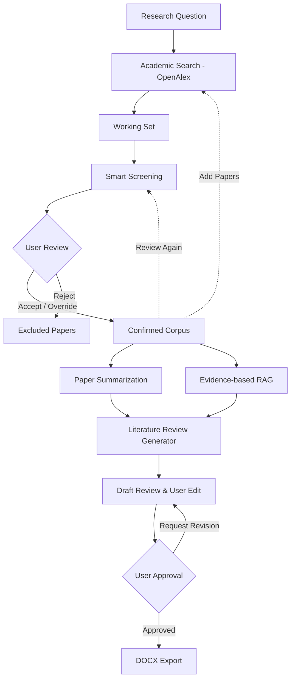

# Project Brief: LitReview Agent

## 1. Project Overview

| Item | Description |
|---|---|
| Project | LitReview Agent |
| Code | EDU-09 |
| Domain | AI Nghiên cứu |
| Timeline | 5 tuần |
| Product | Web application tích hợp AI Agent hỗ trợ quy trình Literature Review |
| Status | Gate 1 – Chốt đề tài, bài toán và thiết kế |

**LitReview Agent** là ứng dụng AI hỗ trợ người nghiên cứu thực hiện quy trình Literature Review, từ tìm kiếm, sàng lọc, tóm tắt bài báo đến hỏi đáp dựa trên bằng chứng và tạo bản nháp tổng quan nghiên cứu.

Sản phẩm được xây dựng dựa trên hai nguyên tắc xuyên suốt:

- **Human-in-the-Loop (HITL):** Người dùng kiểm tra, chỉnh sửa, ghi đè và phê duyệt kết quả AI trước khi sử dụng.
- **Evidence-based:** Nội dung AI tạo ra phải có nguồn và bằng chứng có thể truy xuất. Khi không đủ căn cứ, hệ thống phải thông báo rõ thay vì tự suy diễn.

## 2. Problem Statement

Literature Review đòi hỏi người nghiên cứu tìm kiếm, đọc, sàng lọc, đối chiếu và tổng hợp nhiều công trình khoa học. Quy trình này thường tốn thời gian, dữ liệu phân tán và khó hệ thống hóa. Người nghiên cứu cũng gặp khó khăn khi đánh giá mức độ liên quan của tài liệu và kiểm chứng các luận điểm với nguồn trích dẫn.

Các công cụ AI thông thường có thể hỗ trợ đọc và viết nhanh hơn, nhưng vẫn tồn tại nguy cơ tạo thông tin thiếu căn cứ, trích dẫn không chính xác hoặc đưa ra kết luận không phản ánh đúng tài liệu nguồn.

LitReview Agent hướng đến giải quyết vấn đề bằng cách tích hợp các bước xử lý tài liệu trong một quy trình thống nhất. AI đảm nhận việc hỗ trợ tìm kiếm, phân tích và tổng hợp; người dùng giữ quyền kiểm soát tài liệu được lựa chọn và quyết định cuối cùng đối với nội dung đầu ra.

## 3. Target Users & Pain Points

| Target Users | Vai trò | Pain Points |
|---|---|---|
| Sinh viên đại học làm nghiên cứu khoa học | Người dùng chính | Tốn thời gian tìm kiếm, sàng lọc và xác định tài liệu phù hợp với Research Question |
| Học viên cao học | Người dùng chính | Khó tổng hợp nhiều nghiên cứu, tạo bảng so sánh và kiểm chứng citation |
| Nhà nghiên cứu | Người dùng mở rộng | Cần rà soát tài liệu hiệu quả nhưng vẫn đảm bảo khả năng kiểm chứng nguồn |
| Giảng viên hướng dẫn | Người dùng phụ | Cần xem xét bản nháp và đánh giá tính chính xác của nội dung, trích dẫn |

Quy trình hiện tại thường phân tán giữa công cụ tìm kiếm học thuật, bảng ghi chú, trình soạn thảo và công cụ quản lý citation. Việc chuyển đổi giữa các công cụ làm tăng thời gian xử lý và nguy cơ sai lệch thông tin.

## 4. Proposed Solution

LitReview Agent tích hợp các bước chính của Literature Review trong một quy trình:

Sau khi hình thành Confirmed Corpus, Paper Summarization và Evidence-based RAG là hai nhánh xử lý độc lập. Cả hai cung cấp dữ liệu cho Literature Review Generator; người dùng không cần thực hiện hỏi đáp RAG trước khi tạo bản tổng quan.

Người dùng có thể quay lại tìm kiếm hoặc sàng lọc để bổ sung, điều chỉnh tài liệu. Confirmed Corpus được xác định dựa trên quyết định review của người dùng. Khi corpus thay đổi, các kết quả phụ thuộc phải được đánh dấu cần cập nhật; bản phê duyệt trước đó không còn được xem là phê duyệt cho corpus mới.

AI hỗ trợ xử lý và tổng hợp tài liệu, nhưng người dùng quyết định tài liệu được đưa vào corpus, chỉnh sửa nội dung và phê duyệt báo cáo trước khi xuất.

## 5. Core MVP Features

MVP giới hạn trong **5 tính năng cốt lõi**. HITL và Evidence-based là các nguyên tắc thiết kế xuyên suốt, không phải tính năng độc lập.

### 5.1. Academic Search

Tìm kiếm bài báo khoa học thông qua OpenAlex, hiển thị metadata, abstract, DOI và thông tin thư mục cơ bản. Người dùng lựa chọn bài báo để đưa vào Working Set.

Dữ liệu được phân biệt theo khả năng truy cập:

- `metadata_only`: Bài báo không có abstract.
- `abstract`: Bài báo có abstract.

### 5.2. Smart Screening

AI đánh giá mức độ liên quan giữa bài báo và Research Question dựa trên metadata hoặc abstract, đồng thời cung cấp lý do cho đề xuất.

Phân loại AI (`ai_classification`) gồm bốn giá trị:

- `Relevant`: Phù hợp.
- `Partially Relevant`: Phù hợp một phần.
- `Not Relevant`: Không phù hợp.
- `Insufficient Evidence`: Chưa đủ thông tin để kết luận.

Trạng thái review (`review_status`) gồm:

- `Pending Review`: Chờ người dùng xem xét.
- `Accepted`: Người dùng chấp nhận phân loại AI.
- `Rejected`: Người dùng loại bài báo khỏi Confirmed Corpus.
- `Overridden`: Người dùng thay đổi phân loại AI.

Quy tắc xử lý:

- `ai_classification` được lưu độc lập và không bị ghi đè.
- Với `Accepted`, `final_classification` bằng `ai_classification`.
- Với `Overridden`, `final_classification` do người dùng lựa chọn; `override_note` lưu lý do nếu có.
- Chỉ bài báo có trạng thái `Accepted` hoặc `Overridden` với `final_classification` là `Relevant` hoặc `Partially Relevant` mới được đưa vào Confirmed Corpus.
- Bài báo `Insufficient Evidence` có thể được giữ lại để xem xét thêm, nhưng vẫn ở trạng thái `Pending Review` cho đến khi người dùng quyết định. Việc giữ lại không tự động đưa bài báo vào Confirmed Corpus.
- Hệ thống không tự động loại bỏ hoặc tự động đưa bài báo vào corpus khi chưa có quyết định phù hợp của người dùng.

### 5.3. Paper Summarization

AI tạo bản tóm tắt có cấu trúc theo năm trường:

1. Research Objective
2. Methodology
3. Dataset
4. Results
5. Limitations

Hệ thống chỉ trích xuất thông tin có căn cứ từ dữ liệu hiện có (metadata và abstract), đồng thời ghi nhận nguồn cho từng trường. Trường không có thông tin phải hiển thị **“Không đề cập trong nguồn hiện có”** (*Not mentioned in available source*), thay vì tự suy diễn để hoàn thiện nội dung.

MVP không xử lý toàn văn PDF và không tuyên bố đã đọc hoặc phân tích toàn văn khi chỉ có metadata hoặc abstract.

### 5.4. Evidence-based RAG

Người dùng đặt câu hỏi trên Confirmed Corpus. Hệ thống truy xuất thông tin từ metadata và abstract đã lưu, sau đó tạo câu trả lời kèm citation và evidence để kiểm chứng.

Mỗi **Evidence Chunk** là một đoạn nội dung được trích xuất từ abstract hoặc nguồn văn bản được lưu hợp lệ, gắn với `paper_id`, `source_type`, nội dung và vị trí nguồn nếu có. Evidence phải giữ nguyên nội dung trích dẫn, không được tạo thành đoạn văn giả lập.

Trạng thái trả lời gồm:

- `sufficient_evidence`: Có đủ bằng chứng để trả lời.
- `insufficient_evidence`: Có thông tin liên quan nhưng chưa đủ căn cứ.
- `no_matching_evidence`: Không tìm thấy bằng chứng phù hợp trong corpus.

Khi không đủ bằng chứng, hệ thống phải từ chối đưa ra kết luận thiếu căn cứ. Citation chỉ có metadata được sử dụng để nhận diện bài báo, không dùng để chứng minh methodology, dataset hoặc findings.

### 5.5. Literature Review Generator

Tạo **Comparison Matrix** và **Literature Review Synthesis** dựa trên Confirmed Corpus, Paper Summary và Evidence Chunk.

Generator chủ động truy xuất evidence liên quan từ corpus để hỗ trợ các luận điểm; không phụ thuộc vào việc người dùng đã đặt câu hỏi RAG trước đó và không mặc định sử dụng toàn bộ câu trả lời RAG làm đầu vào.

Các nguyên tắc tạo nội dung:

- Factual claims phải có citation và evidence hỗ trợ.
- Nhận định tổng hợp và diễn giải cũng phải có căn cứ từ corpus.
- Research Gap chỉ được trình bày trong phạm vi corpus đã phân tích, không khẳng định là khoảng trống của toàn bộ lĩnh vực.
- Không tự tạo citation, DOI, kết quả nghiên cứu hoặc luận điểm không có căn cứ.

Người dùng có thể chỉnh sửa và phê duyệt bản nháp trước khi xuất DOCX. Tài liệu xuất gồm:

- Research Question
- Literature Review Synthesis
- Comparison Matrix
- In-text Citations
- References/Bibliography được tạo từ metadata hợp lệ

MVP sử dụng một citation style là APA 7. Khi người dùng chỉnh sửa nội dung hoặc corpus làm thay đổi cơ sở của bản báo cáo, trạng thái phê duyệt phải được cập nhật. Chỉ phiên bản đã được phê duyệt tương ứng với corpus hiện tại mới được phép xuất DOCX.

## 6. Unique Value Proposition

LitReview Agent không chỉ hỗ trợ tạo văn bản mà tập trung vào khả năng kiểm soát và kiểm chứng quy trình Literature Review.

Bốn giá trị khác biệt chính:

1. **User-controlled workflow:** Người dùng xem xét, chỉnh sửa và ghi đè kết quả AI ở các bước quan trọng.
2. **Evidence traceability:** Câu trả lời và nội dung tổng hợp có thể truy xuất về tài liệu và bằng chứng nguồn.
3. **Data transparency:** Phân biệt rõ metadata, abstract và nội dung toàn văn; không giả định AI đã đọc tài liệu chưa được cung cấp.
4. **Approval before export:** Người dùng giữ quyền quyết định cuối cùng đối với bản báo cáo được xuất.

## 7. Objectives & Success Metrics

Mục tiêu là xây dựng và demo MVP LitReview Agent trong **5 tuần với 4 thành viên**, hỗ trợ quy trình từ Academic Search đến DOCX Export sau khi người dùng phê duyệt.

MVP ưu tiên khả năng vận hành end-to-end và tính kiểm chứng của đầu ra. Các chức năng nâng cao được xếp vào Should/Could hoặc ngoài phạm vi theo PRD.

Các chỉ số dưới đây là **mục tiêu đánh giá (target), chưa phải kết quả thực nghiệm**.

| Metric | Target | Measurement |
|---|---:|---|
| Screening Macro-F1 | ≥ 0.80 | Macro-F1 của ba lớp Relevant, Partially Relevant và Not Relevant so với nhãn tham chiếu do con người gán |
| Citation Traceability | 100% | Tỷ lệ citation truy xuất được đến bài báo nguồn hợp lệ trong Confirmed Corpus |
| Citation-Evidence Support | ≥ 80% | Tỷ lệ luận điểm được trích dẫn có evidence thực sự hỗ trợ nội dung, đánh giá trên mẫu do con người chấm |
| Summary Faithfulness | ≥ 80% | Tỷ lệ trường tóm tắt phản ánh đúng thông tin trong nguồn, đánh giá trên mẫu do con người chấm |
| Structured Output Validity | ≥ 95% | Tỷ lệ kết quả cuối cùng tuân thủ schema sau cơ chế retry |
| End-to-End Task Completion | ≥ 80% | Tỷ lệ kịch bản hoàn thành quy trình MVP theo tiêu chí xác định trước |
| Time Reduction (Stretch) | ≥ 50% | Mức giảm thời gian so với quy trình thủ công, tính cả thời gian kiểm tra |

**Quy ước đánh giá:**

- Screening Macro-F1 chỉ tính ba lớp Relevant, Partially Relevant và Not Relevant. `Insufficient Evidence` được đánh giá riêng về khả năng abstention.
- Citation Traceability đo khả năng truy xuất citation đến nguồn hợp lệ; Citation-Evidence Support đo mức độ evidence thực sự hỗ trợ luận điểm. Hai metric độc lập với nhau.
- Structured Output Validity đo tỷ lệ hợp lệ cuối cùng sau retry; tỷ lệ hợp lệ ngay lần đầu cũng được ghi nhận để theo dõi chất lượng đầu ra ban đầu.
- End-to-End Task Completion tính các kịch bản từ tìm kiếm, sàng lọc có xác nhận, tóm tắt, hỏi đáp có evidence hoặc từ chối đúng khi thiếu evidence, tạo bản nháp đến xuất DOCX sau phê duyệt.
- Time Reduction là mục tiêu mở rộng, chỉ đo nếu còn đủ thời gian và không phải điều kiện hoàn thành MVP.
- Các metric được đo trên bộ dữ liệu và kịch bản kiểm thử xác định trước. Chi tiết phương pháp đánh giá được mô tả trong PRD.

## 8. Scope & Data Boundary

### In Scope

MVP bao gồm đúng năm tính năng:

1. Academic Search
2. Smart Screening
3. Paper Summarization
4. Evidence-based RAG
5. Literature Review Generator

Các thành phần hỗ trợ như quản lý session, lưu trạng thái review, summary, evidence, citation và approval là những phần cần thiết để vận hành năm tính năng trên.

### Data Boundary

- **Nguồn tìm kiếm duy nhất:** OpenAlex.
- **Dữ liệu đầu vào:** Metadata và abstract từ OpenAlex; không mặc định có full text hoặc PDF.
- **Source type:** Chỉ gồm `metadata_only` và `abstract` trong MVP.
- **Evidence:** Phải truy xuất được về nguồn và gắn với bài báo tương ứng.
- **Thông tin thiếu:** Phải được thể hiện rõ, không tự suy diễn.
- **Giới hạn triển khai:** SQLite, chunk store trong database, tối đa 50 bài/session, một chủ đề đánh giá, một mẫu DOCX, một citation style (APA 7), một LLM provider. Sử dụng mock để kiểm thử các thành phần phụ thuộc LLM.

PDF/full-text ingestion là Future Scope, không thuộc cam kết MVP.

### Out of Scope

- Tự động viết hoàn chỉnh luận văn, bài báo khoa học hoặc tài liệu học thuật.
- Phân tích dữ liệu nghiên cứu định lượng, chạy thống kê hoặc huấn luyện mô hình nghiên cứu.
- Xử lý toàn văn PDF phức tạp, bảng biểu, hình ảnh hoặc tài liệu bị giới hạn truy cập.
- Kiểm tra đạo văn, dịch thuật tự động và quản lý thư viện citation nâng cao.
- Tích hợp nhiều nguồn tìm kiếm học thuật ngoài OpenAlex.
- Xây dựng hệ thống cộng tác nghiên cứu phức tạp.
- Cam kết độ chính xác tuyệt đối hoặc loại bỏ hoàn toàn hallucination.

## 9. Timeline & Deliverables

| Week | Milestone | Key Deliverables |
|---|---|---|
| Week 1 | Foundation & Academic Search | Architecture, DB schema, API contracts, repository/CI, OpenAlex connector, Search API, session creation |
| Week 2 | Working Set & Smart Screening | Working Set, screening classification, schema validation, user review (accept/reject/override), Confirmed Corpus, session state |
| Week 3 | Summarization & Core Integration | Five-field summary with provenance, session persistence, end-to-end Search → Confirmed Corpus → Summary, evaluation dataset |
| Week 4 | Evidence-based RAG & Generator Foundation | Evidence chunks, RAG answer status, citation resolution, no-evidence tests, comparison matrix and synthesis draft |
| Week 5 | Final Integration & Delivery | Approval workflow, DOCX export, integration testing, evaluation, demo and evaluation report with limitations |

Unit test và smoke test được thực hiện từ Week 1; Week 5 là giai đoạn tổng kiểm thử, không phải lần đầu kiểm thử. Generator cần có smoke test với corpus nhỏ từ Week 3 để giảm rủi ro tích hợp cuối kỳ.

Việc triển khai được tổ chức theo bốn workstream:

- Backend & Data
- Agent & AI
- Frontend & UX
- QA & Integration

Phân công chi tiết, mức ưu tiên Must/Should/Could, phụ thuộc kỹ thuật và tiêu chí nghiệm thu được quy định trong PRD.

### Deliverables

| Milestone | Deliverables |
|---|---|
| Gate 1 | Project Brief, PRD, Wireframe/UI Flow, GitHub Repository và AI Log Setup |
| Final Project | MVP Web Application, Source Code, Technical Documentation, Evaluation Report, User Guide, Deployment và Demo Materials |