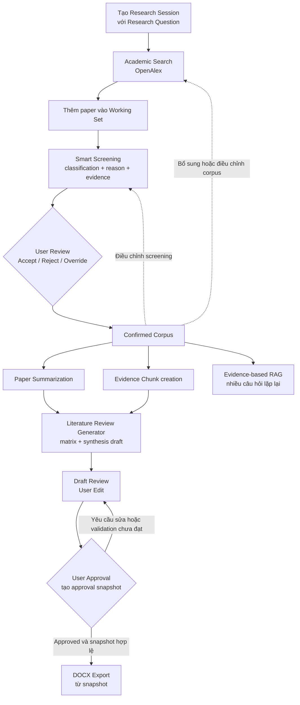

# PRD v1.0 – LitReview Agent (EDU-09)

## 1. Thông tin tài liệu

| Hạng mục | Nội dung |
|---|---|
| Tên sản phẩm | LitReview Agent |
| Mã dự án | EDU-09 |
| Team | P-107 |
| Domain | AI Research |
| Timeline | 5 tuần, 4 thành viên |
| Stage | Gate 1 – Product Definition & Design |
| Version | 1.0 (MVP) |
| Nguồn tham chiếu | `docs/01-project-brief.md`; revision brief của PRD |
| Trạng thái | Xác nhận|

---

## 2. Tổng quan sản phẩm

LitReview Agent là web application hỗ trợ quy trình Literature Review có hệ thống: tìm kiếm bài báo học thuật, sàng lọc, tóm tắt, hỏi đáp có evidence và tạo bản nháp Literature Review đã được người dùng duyệt để xuất DOCX.

### 2.1. Nguyên tắc sản phẩm

- **Human-in-the-Loop (HITL):** Người dùng ra mọi quyết định có hệ quả — đưa paper vào corpus, ghi đè kết quả AI, phê duyệt nội dung.
- **Evidence-based:** Mọi phát biểu do AI tạo ra phải gắn với citation và evidence truy xuất được về nguồn.
- **Không bịa nội dung:** Không tự tạo findings, citation, DOI hoặc thông tin thư mục không có trong nguồn.
- **Minh bạch phạm vi dữ liệu:** Không tuyên bố đã đọc toàn văn khi chỉ có metadata hoặc abstract.
- **Không lấp chỗ trống:** Thông tin thiếu được thể hiện là thiếu (`Not mentioned in available source`), không suy diễn.
- **Tổng hợp trong phạm vi corpus:** Research gap chỉ diễn đạt trong Confirmed Corpus.
- **Một workflow:** Một LangGraph workflow với các node có trách nhiệm rõ ràng; không multi-agent trong MVP.
- **Ưu tiên khả thi:** Demo end-to-end trong 5 tuần; PDF processing và vector database không thuộc MVP.

Trong MVP chỉ có hai loại nguồn nội dung, được ghi qua `source_type`: `metadata_only` (chỉ metadata, không abstract) và `abstract` (metadata + abstract). Định nghĩa đầy đủ của các thuật ngữ nằm ở Appendix A.1.

---

## 3. Problem Statement & Target Users

### 3.1. Problem Statement

Literature Review tốn thời gian và phân tán: người nghiên cứu chuyển giữa công cụ tìm kiếm học thuật, ghi chú, trình soạn thảo và citation manager. Đánh giá độ liên quan, so sánh các nghiên cứu và kiểm chứng một luận điểm có được nguồn hỗ trợ đều tốn công.

Các công cụ AI viết văn thông thường có nguy cơ: tạo citation không có thật, mô tả sai abstract, suy diễn methodology/dataset/findings khi nguồn không đề cập, kết luận vượt bằng chứng, làm mất khả năng truy xuất nguồn gốc.

LitReview Agent giải quyết bằng một workflow có kiểm soát: AI làm retrieval, screening, extraction, summarization và drafting; người dùng quyết định paper nào vào Confirmed Corpus, chỉnh sửa Summary/Draft, và chỉ nội dung đã Approval được xuất DOCX. Mục tiêu không phải thay thế người nghiên cứu mà giảm công việc thủ công trong khi giữ khả năng kiểm chứng và quyền quyết định.

### 3.2. Target Users & Personas

| Persona | Vai trò | Nhu cầu | Pain point |
|---|---|---|---|
| Sinh viên làm nghiên cứu | Chính | Tìm và sàng lọc paper phù hợp với Research Question | Tìm kiếm và sàng lọc chậm |
| Học viên cao học | Chính | So sánh nghiên cứu, dựng bảng so sánh, kiểm chứng citation | Khó tổng hợp và kiểm chứng nguồn |
| Nhà nghiên cứu | Phụ | Khảo sát nhanh một lĩnh vực với nguồn truy xuất được | Cân bằng tốc độ và độ kiểm chứng |
| Giảng viên hướng dẫn | Người review | Kiểm tra độ chính xác và chất lượng citation | Ít thời gian kiểm từng citation |

Ngoài phạm vi người dùng MVP: tổ chức/nhóm nhiều thành viên, cộng tác đa người dùng, phân quyền theo vai trò, review nhiều cấp.

---

## 4. Product Goals & Success Criteria

- **G1 – End-to-end MVP:** Hoàn thành cả 5 tính năng MVP trong 5 tuần, có demo từ Research Question đến DOCX đã Approved.
- **G2 – Evidence traceability:** Nội dung AI gắn với nguồn truy xuất được, đúng phạm vi từng giai đoạn — Screening dùng dữ liệu của paper trong Working Set; Summarization dùng nguồn hiện có của paper; RAG và Generator chỉ dùng Confirmed Corpus hiện hành cùng Summary và Evidence Chunk hợp lệ. Không yêu cầu mọi output dùng Confirmed Corpus làm nguồn vì Screening diễn ra trước khi paper vào corpus.
- **G3 – Human control:** Classification, Summary, Draft đều xem lại được; người dùng kiểm soát việc đưa paper vào corpus, sửa Summary và phê duyệt Draft.
- **G4 – Efficiency (Stretch):** Rút ngắn thời gian tạo bản nháp đầu tiên so với quy trình thủ công.

Success metrics được định nghĩa tại Mục 14; các con số ở đó là **target đánh giá, không phải kết quả thực nghiệm**.

---

## 5. Scope & Out of Scope

### 5.1. Phân loại scope MVP

| Mức | Ý nghĩa | Hạng mục |
|---|---|---|
| **Must** | Bắt buộc để demo MVP end-to-end | Academic Search; Working Set; Smart Screening có user decision; Confirmed Corpus; Summary có provenance từng trường và chỉnh sửa; Evidence-based RAG có evidence và citation; Generator có citation; Claim validation và Approval gate; DOCX export; session persistence; no-fabrication và traceability |
| **Should** | Chỉ làm nếu còn thời gian; thứ tự cắt ở Mục 14.2 | Paginated search (FR-SRCH-07); draft version history (FR-APR-06); session rename/delete (FR-SES-06) |
| **Could** | Sau MVP | Định dạng Draft phong phú hơn; thêm DOCX template; xuất riêng Comparison Matrix; cache câu trả lời RAG |
| **Out of Scope (5 tuần)** | Không triển khai | Xem 5.3 |

### 5.2. Giảm scope để phù hợp timeline 5 tuần

Giảm độ phức tạp triển khai, không giảm nguyên tắc sản phẩm:

- SQLite là database duy nhất của MVP; PostgreSQL chỉ xem xét sau MVP.
- Evidence Chunk lưu trong database; không dùng vector database riêng.
- Frontend SPA đơn giản.
- Tối đa 50 paper/session (có thể cấu hình).
- Giới hạn abstract đưa vào LLM theo tác vụ — hai giới hạn vận hành khác nhau: Screening 300 từ/paper (batch 10 paper); Summarization 2.000 từ/abstract.
- Abstract gốc được lưu nguyên vẹn trong database. Vượt giới hạn đầu vào LLM thì hệ thống dùng phần đầu abstract theo giới hạn tương ứng, không sửa/ghi đè abstract gốc; ghi nhận nội dung thực tế đã gửi, giới hạn áp dụng, trạng thái `truncated`, tác vụ và paper; UI thông báo khi kết quả được tạo từ abstract đã rút gọn. Không cắt âm thầm.
- Một chủ đề đánh giá, một bộ dữ liệu gán nhãn, một LLM provider, một DOCX template, một citation style (APA 7).
- Không xử lý PDF.

Các giảm thiểu không loại bỏ HITL, no-fabrication, user review, evidence traceability hoặc approval gate.

### 5.3. Out of Scope

- Tự viết hoàn chỉnh luận văn/bài báo khoa học; phân tích định lượng, kiểm định thống kê, huấn luyện mô hình.
- Xử lý full-text PDF, bảng biểu, hình ảnh, tài liệu giới hạn truy cập.
- Kiểm tra đạo văn, dịch tự động, citation manager nâng cao.
- Nguồn học thuật ngoài OpenAlex.
- Cộng tác đa người dùng, phân quyền phức tạp, multi-agent.
- Cam kết độ chính xác tuyệt đối hoặc loại bỏ hoàn toàn hallucination.
- Vector database (ví dụ Qdrant) và dịch vụ retrieval riêng.

---

## 6. User Journey & Workflow

### 6.1. Workflow tổng thể

### 6.2. Quy tắc vận hành

- Sau Confirmed Corpus có ba nhánh độc lập: Summarization, Evidence Chunk creation, RAG Q&A. RAG là chức năng hỏi đáp độc lập, không phải điều kiện tiên quyết của Generator (FR-GEN-02); người dùng không cần chạy RAG trước khi tạo Draft.
- Chỉ paper thuộc Confirmed Corpus hiện hành được dùng cho Summarization, RAG và Generator.
- Người dùng quay lại Search hoặc Screening bất cứ lúc nào. Membership corpus thay đổi → `corpus_version` tăng (FR-SES-07) → Matrix/Draft stale, Approval cũ invalidate (mục 17.2, Invalidation Rules).
- Summary hoặc Evidence thay đổi mà membership không đổi → `input_fingerprint` lệch → artifact stale (mục 17.2, Input Fingerprint).
- RAG Exchange cũ giữ nguyên như lịch sử tại thời điểm hỏi; câu trả lời mới dùng corpus hiện hành (FR-RAG-12).
- DOCX chỉ xuất từ Approval Snapshot hợp lệ; không gọi LLM lúc export (FR-APR-05).

### 6.3. Điều kiện hoàn thành demo end-to-end

Demo hoàn thành khi người dùng thực hiện được: (1) tạo session với Research Question; (2) search và thêm paper vào Working Set; (3) chạy Screening và xem classification + reason + evidence; (4) Accept/Reject/Override; (5) tạo Confirmed Corpus; (6) tạo Summary và xem provenance từng trường; (7) hỏi RAG và kiểm tra citation/evidence; (8) tạo Matrix và Synthesis không cần RAG trước; (9) review và sửa Draft; (10) chạy claim validation và xử lý claim chưa đủ căn cứ; (11) Approval; (12) export DOCX từ Approval Snapshot. Demo thể hiện rõ giới hạn dữ liệu: chỉ metadata và abstract, không full-text PDF.

---

## 7. Functional Requirements

Priority: **M** = Must (bắt buộc cho MVP), **S** = Should (làm nếu còn thời gian).

### 7.1. Academic Search (SRCH)

| ID | Requirement | Priority |
|---|---|---|
| FR-SRCH-01 | Người dùng nhập query text tự do và nhận kết quả paper từ OpenAlex. | M |
| FR-SRCH-02 | Mỗi kết quả hiển thị title, authors, year, venue, DOI, OpenAlex ID và abstract (hoặc "Abstract not available"). | M |
| FR-SRCH-03 | Người dùng thêm kết quả đã chọn vào Working Set của session hiện tại. | M |
| FR-SRCH-04 | Một paper trùng OpenAlex ID hoặc DOI đã chuẩn hóa không thêm được hai lần vào cùng một session. DOI chuẩn hóa trước khi kiểm tra trùng. | M |
| FR-SRCH-05 | OpenAlex lỗi hoặc timeout thì UI hiển thị lỗi kèm retry; kết quả tải dở không được trình bày như kết quả hoàn chỉnh. | M |
| FR-SRCH-06 | Paper không có abstract lưu `source_type = metadata_only`; có abstract lưu `source_type = abstract`. MVP không có giá trị `source_type` khác. | M |
| FR-SRCH-07 | Kết quả phân trang với page size cố định, ghi rõ trong tài liệu kỹ thuật và UI. | S |

### 7.2. Smart Screening (SCRN)

Screening đánh giá mức độ phù hợp dựa trên **Research Question của session hiện tại**. Mỗi Screening Result tách hai lớp trạng thái — **nghiệp vụ** (nhãn AI + quyết định người dùng) và **thực thi** (tiến trình AI + lỗi kỹ thuật); không dùng nhãn nghiệp vụ đại diện cho lỗi kỹ thuật.

| ID | Requirement | Priority |
|---|---|---|
| FR-SCRN-01 | Khi `classification_status = completed`, mỗi paper có đúng một `ai_classification` thuộc {`Relevant`, `Partially Relevant`, `Not Relevant`, `Insufficient Evidence`}. Khi còn `pending`/`processing`/`failed`/`timeout`, paper chưa có `ai_classification`. | M |
| FR-SCRN-02 | Mỗi `ai_classification` có `reason` chỉ dựa trên Research Question và dữ liệu đã lưu, kèm evidence truy xuất được: Paper ID, source type (`metadata_only`/`abstract`), source reference (trường metadata hoặc đoạn abstract nguồn) và snippet nguyên văn khi có. | M |
| FR-SCRN-03 | Mỗi Screening Result có `review_status`: `Pending Review` (mặc định), `Accepted`, `Rejected`, `Overridden`. Khi AI chưa phân loại thành công, paper giữ `Pending Review` và chưa được phép Accept/Override. | M |
| FR-SCRN-04 | Accept (`Accepted`; `final_classification = ai_classification`) chỉ áp dụng cho `Relevant`, `Partially Relevant`, `Not Relevant`. Reject (`Rejected`; không có `final_classification`). Override (`Overridden`; `final_classification` do người dùng chọn trong ba nhãn trên; `override_note` tùy chọn). `ai_classification` không bao giờ bị ghi đè. | M |
| FR-SCRN-05 | `Insufficient Evidence` hiển thị "không đủ thông tin để đánh giá". Không được Accept trực tiếp; người dùng giữ `Pending Review` để xem thêm, Reject, hoặc Override thành ba nhãn trên khi đủ căn cứ. Giữ để xem sau không đưa paper vào corpus. | M |
| FR-SCRN-06 | Không paper nào bị loại tự động; chỉ quyết định người dùng đặt `review_status`. Lỗi kỹ thuật không được coi là quyết định loại paper. | M |
| FR-SCRN-07 | Confirmed Corpus chỉ gồm paper có `review_status` ∈ {`Accepted`, `Overridden`} và `final_classification` ∈ {`Relevant`, `Partially Relevant`}. Paper `Insufficient Evidence` chỉ vào corpus nếu người dùng Override thành `Relevant`/`Partially Relevant`. `corpus_version` chỉ tăng khi membership thay đổi (FR-SES-07). | M |
| FR-SCRN-08 | Trạng thái thực thi tách khỏi nhãn nghiệp vụ: `classification_status` ∈ {`pending`, `processing`, `completed`, `failed`, `timeout`}; `classification_error` (tùy chọn) lưu lỗi. `Insufficient Evidence` chỉ dùng khi AI chạy xong nhưng thiếu căn cứ, không dùng cho lỗi kỹ thuật. | M |
| FR-SCRN-09 | Output phân loại được validate theo schema trước khi lưu; output không hợp lệ retry một lần. Lỗi kỹ thuật sau retry: `classification_status` giữ `failed`/`timeout` kèm `classification_error`; UI hiển thị lỗi riêng với nút retry. Paper chưa có `ai_classification`, không bị gán nhãn giả, chưa được Accept/Override cho đến khi phân loại thành công. | M |
| FR-SCRN-10 | Metric screening tính theo Mục 14: Macro-F1 trên ba lớp nghiệp vụ, kèm Abstention Rate và Selective Coverage; `Insufficient Evidence` đánh giá riêng; tỷ lệ lỗi kỹ thuật báo cáo riêng. | M |

### 7.3. Paper Summarization (SUMM)

| ID | Requirement | Priority |
|---|---|---|
| FR-SUMM-01 | Với paper trong Confirmed Corpus, tạo Summary 5 trường: Research Objective, Methodology, Dataset, Results, Limitations. | M |
| FR-SUMM-02 | Mỗi trường chỉ điền từ nguồn hiện có. Trường thiếu hiển thị "Không đề cập trong nguồn hiện có" (Not mentioned in available source). | M |
| FR-SUMM-03 | Mỗi Summary ghi `source_type` và lưu provenance theo từng trường: Paper ID + trường metadata/abstract nguồn tương ứng. | M |
| FR-SUMM-04 | UI không bao giờ nói đã đọc full text; chỉ nêu nguồn là metadata hay abstract. | M |
| FR-SUMM-05 | Người dùng sửa được từng trường; trường đã sửa đánh dấu `user_edited` và giữ provenance gốc. | M |
| FR-SUMM-06 | Summarization hoàn tất hoặc trả trạng thái timeout/lỗi rõ ràng, trong giới hạn NFR-PERF-03. | M |
| FR-SUMM-07 | Summarization chạy độc lập với RAG, chỉ phụ thuộc nguồn của paper trong Confirmed Corpus. | M |
| FR-SUMM-08 | Metadata (title, authors, year, venue, DOI) không dùng làm căn cứ khẳng định methodology, dataset hoặc findings. | M |

### 7.4. Evidence-based RAG (RAG)

| ID | Requirement | Priority |
|---|---|---|
| FR-RAG-01 | Người dùng đặt nhiều câu hỏi trong phạm vi Confirmed Corpus của session. RAG không yêu cầu Summary tồn tại trước. | M |
| FR-RAG-02 | Response gồm tối thiểu `answer`, `answer_status`, `citations`, `evidence`. | M |
| FR-RAG-03 | `answer_status` ∈ {`sufficient_evidence` (đủ evidence để trả lời), `insufficient_evidence` (có evidence liên quan nhưng chưa đủ kết luận), `no_matching_evidence` (không có evidence phù hợp trong corpus)}. | M |
| FR-RAG-04 | Mọi citation của câu trả lời mới phải trỏ tới paper thuộc Confirmed Corpus hiện hành; citation ngoài corpus bị từ chối. | M |
| FR-RAG-05 | Mỗi evidence là trích nguyên văn từ abstract đã lưu, kèm Paper ID, Source Type (`abstract`) và Chunk ID. Chưa có Evidence Chunk thì hệ thống tạo chunk hoặc xác định vị trí nguồn trước khi trả evidence; không để citation evidence không truy xuất được. | M |
| FR-RAG-06 | Không tạo citation khi không có nguồn hỗ trợ; khi đó `answer_status = no_matching_evidence` và `citations` rỗng. | M |
| FR-RAG-07 | Evidence trích trực tiếp hiển thị tách biệt với phần diễn giải của AI, có nhãn rõ. | M |
| FR-RAG-08 | Câu hỏi ngoài phạm vi corpus trả `no_matching_evidence` kèm thông báo corpus không bao phủ câu hỏi. | M |
| FR-RAG-09 | Điểm retrieval không hiển thị như độ chính xác hoặc độ tin cậy của câu trả lời. | M |
| FR-RAG-10 | Citation metadata-only chỉ dùng để nhận diện paper; không dùng để chứng minh methodology, dataset hoặc findings. | M |
| FR-RAG-11 | Hệ thống không tuyên bố RAG loại bỏ hoàn toàn hallucination; chỉ nêu giới hạn nguồn và cơ chế kiểm chứng. | M |
| FR-RAG-12 | RAG luôn truy xuất trên Confirmed Corpus hiện hành theo `corpus_version`. Corpus thay đổi thì câu trả lời mới dùng corpus mới; lịch sử RAG cũ giữ nguyên như bản ghi thời điểm hỏi (gồm `corpus_version`, `citation_ids`, `evidence_chunk_ids`, evidence snapshot). Citation/evidence lịch sử xem lại được nhưng không tái sử dụng làm nguồn cho RAG/Generator mới nếu paper không còn thuộc corpus (phân biệt Active/Historical Citation: mục 10.3). | M |

### 7.5. Literature Review Generator (GEN)

**Dependency:** Generator nhận Research Question (phạm vi tổng hợp), Paper Metadata (hiển thị thư mục), Paper Summary và Evidence Chunk thuộc Confirmed Corpus hiện hành (nguồn nội dung), và chủ động truy xuất evidence từ corpus khi tạo nội dung. Generator **không** lấy đầu vào từ RAG Q&A và không yêu cầu người dùng đã hỏi RAG.

| ID | Requirement | Priority |
|---|---|---|
| FR-GEN-01 | Comparison Matrix: một dòng mỗi paper trong corpus, kể cả paper chưa có Summary. Cột: paper, year, objective, methodology, dataset, results, limitations, source_type. Metadata dùng để hiển thị thư mục; Summary/Evidence dùng cho nội dung nghiên cứu. Giá trị thiếu hiển thị "Not available"; không suy diễn. | M |
| FR-GEN-02 | Synthesis chỉ dựng từ Paper Summary và Evidence Chunk của corpus hiện hành, trong phạm vi Research Question. Generator chủ động truy xuất evidence liên quan. Chỉ dùng bằng chứng thực sự có; không tạo dữ liệu giả; không đủ evidence cho một luận điểm thì ghi rõ giới hạn hoặc bỏ luận điểm (abstain), không suy diễn. | M |
| FR-GEN-03 | Mỗi Generated Claim thuộc một trong ba loại `claim_type`: `factual` (ít nhất một citation và evidence), `synthesis` (tổng hợp nhiều nguồn, mỗi nguồn có citation và evidence), `interpretation` (gắn nhãn, có căn cứ từ corpus). Nhãn interpretation không hợp thức hóa nhận định không có bằng chứng; claim chỉ có metadata-only không được trình bày như kết luận về methodology, dataset hoặc findings. Định nghĩa `support_status`: `supported` = evidence hỗ trợ toàn bộ nội dung; `partially_supported` = chỉ hỗ trợ một phần; `unsupported` = không có evidence đủ hỗ trợ. Mỗi claim lưu bản ghi Generated Claim theo Data Model (mục 17.2, Generated Claim Validation). | M |
| FR-GEN-04 | Research gap chỉ diễn đạt trong phạm vi corpus (ví dụ "không paper nào trong corpus đề cập X"); không khẳng định là khoảng trống của toàn lĩnh vực. | M |
| FR-GEN-05 | Người dùng sửa được Draft. Mỗi lần sửa lưu nội dung, tính lại `content_hash`, đặt `Pending Review` (FR-APR-01). Mỗi claim gắn `content_block_id`, `draft_version`, `claim_text`, `claim_hash`. Claim text thay đổi → validation cũ stale, claim phải được đánh giá lại trước Approval; không tái sử dụng validation cũ cho nội dung đã thay đổi. Lịch sử version đầy đủ là FR-APR-06 (Should). | M |
| FR-GEN-06 | Claim `unsupported` phải được loại khỏi nội dung đủ điều kiện Approval hoặc chỉnh sửa thành claim mới có căn cứ và đánh giá lại; có thể giữ trong dữ liệu kiểm tra nhưng không được trình bày như kết luận được hỗ trợ. Claim `partially_supported` được cảnh báo và hiển thị phần evidence chưa hỗ trợ; để đủ điều kiện Approval, người dùng phải (a) chỉnh sửa claim giới hạn trong phạm vi evidence hỗ trợ và đánh giá lại thành `supported`, hoặc (b) loại bỏ claim. Claim partially_supported chưa xử lý có thể giữ ở vùng nháp cần review nhưng không vào nội dung Approved. Xác nhận cảnh báo không tự chuyển `partially_supported`/`unsupported` thành `supported`. | M |
| FR-GEN-07 | References chỉ gồm paper được trích dẫn (đều thuộc corpus), lấy từ Paper Metadata (title, authors, year, venue, DOI). Trường thiếu hiển thị "not available", không tự điền. | M |
| FR-GEN-08 | Cấu trúc DOCX tối thiểu: Research Question; Literature Review Synthesis; Comparison Matrix; In-text Citations; References/Bibliography. | M |
| FR-GEN-09 | MVP chỉ hỗ trợ một citation style: APA 7. | M |
| FR-GEN-10 | `corpus_version` thay đổi sau khi Matrix/Draft tạo → artifact đánh dấu `stale`, UI cảnh báo, yêu cầu rebuild trước khi duyệt lại; Draft stale không thể Approval. Summary/Evidence Chunk/nguồn đầu vào thay đổi mà membership không đổi → hệ thống phát hiện qua `input_fingerprint` (mục 17.2, Input Fingerprint) và đánh dấu stale. | M |
| FR-GEN-11 | Trước Approval, hệ thống kiểm tra toàn bộ Generated Claim còn trong nội dung Draft sẽ duyệt. Không cho phép Approval nếu: (a) còn claim `unsupported`; (b) còn claim `partially_supported` chưa xử lý theo FR-GEN-06; (c) còn claim chưa đánh giá lại sau khi nội dung thay đổi; (d) claim không khớp nội dung hiện tại. Chỉ claim còn trong nội dung thực tế được duyệt mới được kiểm tra; xác nhận cảnh báo không thay đổi `support_status`. | M |

### 7.6. Human-in-the-Loop (HITL)

| ID | Requirement | Priority |
|---|---|---|
| FR-HITL-01 | Classification phải được người dùng Accept hoặc Override hợp lệ trước khi paper vào Confirmed Corpus. | M |
| FR-HITL-02 | Phải có Approval trước khi export DOCX (FR-APR-04). | M |
| FR-HITL-03 | Mọi quyết định và chỉnh sửa của người dùng được ghi timestamp. | M |

### 7.7. Citation & Evidence (CIT)

Quy tắc chuẩn hóa Evidence Chunk (áp dụng cho FR-RAG, FR-CIT, Appendix A):

- MVP chỉ tạo Evidence Chunk từ abstract đã lưu; `source_type` của Evidence Chunk luôn là `abstract`.
- Metadata dùng để nhận diện paper, tạo bibliography, hiển thị nguồn; không phải bằng chứng cho Methodology/Dataset/Results/Findings (FR-RAG-10, FR-SUMM-08).
- Mỗi Evidence Chunk có: `chunk_id`, `paper_id`, `session_id`, `source_type`, `content` (nguyên văn, bảo toàn trích dẫn), thông tin vị trí nguồn khi có.
- Segmentation đơn giản, deterministic, dễ kiểm thử (theo câu hoặc khoảng ký tự cố định bảo toàn ranh giới câu). Không xây dựng chunking pipeline phức tạp. Quy tắc cụ thể nhóm chốt trong W3, ghi tài liệu kỹ thuật.

| ID | Requirement | Priority |
|---|---|---|
| FR-CIT-01 | Mỗi citation resolve tới paper record đã lưu trong đúng session hiện hành, tối thiểu có title và year. Citation dùng cho RAG/Generator mới phải thuộc Confirmed Corpus hiện hành; citation lịch sử chỉ resolve trong ngữ cảnh bản ghi tương ứng (mục 10.3); không tham chiếu chéo session. | M |
| FR-CIT-02 | Mỗi evidence mở xem được và hiển thị đúng `content` đã lưu nguyên văn, kèm Paper ID và source type. | M |
| FR-CIT-03 | Citation không resolve được thì UI báo lỗi và không hiển thị như citation hợp lệ. | M |

### 7.8. Session Management (SES)

| ID | Requirement | Priority |
|---|---|---|
| FR-SES-01 | Người dùng tạo Research Session với Research Question. | M |
| FR-SES-02 | Session lưu vào database và mở lại được sau khi khởi động lại ứng dụng. | M |
| FR-SES-03 | Dữ liệu session (paper, quyết định, Summary, lịch sử RAG, Draft) cô lập theo session. | M |
| FR-SES-04 | Quyết định Screening và chỉnh sửa của người dùng giữ sau reload. | M |
| FR-SES-05 | Trước khi ghi đè giá trị người dùng đã sửa (Summary, override note, Draft), hệ thống yêu cầu xác nhận hoặc giữ bản trước; không ghi đè âm thầm. | M |
| FR-SES-06 | Người dùng đổi tên hoặc xóa session; xóa cần xác nhận. | S |
| FR-SES-07 | Mỗi session có `corpus_version` (số nguyên, bắt đầu 1), chỉ tăng thêm 1 khi membership của Confirmed Corpus thay đổi. Ví dụ: Accepted Relevant → Overridden Relevant (vẫn trong corpus) không tăng; Accepted Relevant → Rejected tăng; Rejected → Overridden Relevant tăng; sửa `override_note` không đổi membership không tăng. `corpus_version` hiện hành được ghi vào RAG Exchange và Approval. `corpus_version` chỉ theo dõi membership, không thay thế `input_fingerprint`. | M |

### 7.9. Approval & Export (APR)

Thiết kế Approval và định nghĩa các loại hash (claim/content/fingerprint/export) nằm tại mục 17.2; quy tắc invalidation tại mục 17.2. Quy tắc cốt lõi:

- Approval tạo **Approval Snapshot bất biến** của canonical content (toàn bộ nội dung có thể xuất DOCX — mục 17.2).
- DOCX chỉ sinh từ Approval Snapshot; không gọi LLM lúc export.
- Hash so sánh điều kiện export là hash canonical content, không phải hash binary DOCX.
- Một Approval Snapshot dùng được cho nhiều lần export; mỗi lần export tạo một Export Record riêng.

| ID | Requirement | Priority |
|---|---|---|
| FR-APR-01 | Draft ở `Pending Review` khi vừa tạo và sau mọi thay đổi nội dung. | M |
| FR-APR-02 | Người dùng đặt `Approved`; hệ thống tạo Approval Snapshot: `approval_id`, `approved_version`, `approved_content_snapshot`, `approved_content_hash`, `approved_corpus_version`, `input_fingerprint`, `approved_at`. | M |
| FR-APR-03 | Mọi thay đổi nội dung trên Draft đã Approved đưa trạng thái về `Pending Review` và vô hiệu Approval cũ. | M |
| FR-APR-04 | DOCX export chỉ khả dụng khi đồng thời: (a) Draft status = `Approved`; (b) current canonical content hash = `approved_content_hash`; (c) current `corpus_version` = `approved_corpus_version`; (d) `input_fingerprint` hiện tại khớp; (e) Approval Snapshot chưa bị invalidate; (f) mọi Generated Claim còn trong nội dung được duyệt đủ điều kiện theo FR-GEN-06 và FR-GEN-11. | M |
| FR-APR-05 | DOCX sinh chỉ từ `approved_content_snapshot`, khớp `approved_content_hash` tại thời điểm sinh. Không gọi LLM. Mỗi file DOCX tạo một Export Record với `export_file_hash` riêng (hash binary — không thay thế `approved_content_hash`). | M |
| FR-APR-06 | Lưu current Draft version là Must; lưu toàn bộ lịch sử version là Should. Dù mức nào, Approval Snapshot phải bất biến để FR-APR-05 luôn đúng. | S |
| FR-APR-07 | Sửa nội dung đã Approved → Approval cũ invalidated, export chặn cho đến khi Approval lại phiên bản mới. | M |
| FR-APR-08 | `corpus_version` thay đổi sau Approval → Approval invalidated, export chặn cho đến khi rebuild theo corpus mới và Approval lại. | M |
| FR-APR-09 | Approval kiểm tra trạng thái evidence của các Generated Claim còn trong Draft sẽ duyệt. Còn claim `unsupported`, claim `partially_supported` chưa xử lý, hoặc claim chưa đánh giá lại sau sửa → chặn Approval, chỉ rõ claim cần sửa/đánh giá lại/loại bỏ. Không cho bỏ qua kiểm tra bằng cách xác nhận cảnh báo. | M |

---

## 8. Acceptance Criteria

Acceptance Criteria kiểm chứng từng User Story. Quy tắc nghiệp vụ đầy đủ nằm ở Mục 7; mỗi AC tham chiếu FR tương ứng.

### US-01. Tìm paper

Là người nghiên cứu, tôi muốn tìm trên OpenAlex theo chủ đề để nhanh chóng có danh sách paper ứng viên.

- **AC-01.1:** Query trả kết quả có title, authors, year, venue, DOI, OpenAlex ID và abstract hoặc "Abstract not available". [FR-SRCH-01, 02, 06]
- **AC-01.2:** OpenAlex không khả dụng thì UI báo lỗi có retry, không lưu kết quả dở như một lần tìm kiếm hoàn chỉnh. [FR-SRCH-05]
- **AC-01.3:** `source_type` của mọi paper chỉ nhận `metadata_only` hoặc `abstract`. [FR-SRCH-06]
- **AC-01.4:** Paper trùng OpenAlex ID hoặc DOI đã chuẩn hóa không thêm được lần thứ hai vào cùng session. [FR-SRCH-04]

### US-02. Dựng Working Set

Là người nghiên cứu, tôi muốn thêm paper ứng viên vào Working Set để sàng lọc.

- **AC-02.1:** Thêm cùng một paper hai lần trong một session chỉ tạo một entry. [FR-SRCH-03, 04]
- **AC-02.2:** Paper được thêm vào đúng Research Session hiện tại, không xuất hiện trong Working Set của session khác. [FR-SES-03]

### US-03. Sàng lọc với AI

Là người nghiên cứu, tôi muốn AI đề xuất độ liên quan kèm lý do và evidence để review nhanh hơn.

- **AC-03.1:** Nếu `classification_status = completed`, paper có đúng một `ai_classification` thuộc bốn nhãn đã định nghĩa; nếu `classification_status` là `pending`/`processing`/`failed`/`timeout`, paper chưa có `ai_classification`. [FR-SCRN-01, 08]
- **AC-03.2:** Mỗi classification có reason kèm evidence truy xuất được: Paper ID, source type, source reference và snippet nguyên văn khi có. [FR-SCRN-02]
- **AC-03.3:** Không paper nào bị xóa khi bị phân loại `Not Relevant` hoặc `Insufficient Evidence`. [FR-SCRN-06]
- **AC-03.4:** LLM lỗi kỹ thuật sau retry: paper hiển thị `failed`/`timeout` kèm `classification_error` và nút retry; chưa có `ai_classification`; không gán nhãn nghiệp vụ thay cho lỗi. [FR-SCRN-08, 09]
- **AC-03.5:** `Insufficient Evidence` hiển thị "không đủ thông tin để đánh giá", không bị đếm như `Not Relevant`; không cho Accept trực tiếp; paper giữ `Pending Review` cho đến khi người dùng Reject hoặc Override. [FR-SCRN-05]
- **AC-03.6:** `classification_status` và `review_status` tách biệt; lỗi kỹ thuật không xuất hiện dưới dạng nhãn `Insufficient Evidence`; paper chưa phân loại thành công không được Accept/Override. [FR-SCRN-08, 09]
- **AC-03.7:** Screening dùng Research Question của session hiện tại; không dùng Research Question hoặc dữ liệu của session khác. [FR-SCRN-01, 02]

### US-04. Ghi đè quyết định AI

Là người nghiên cứu, tôi muốn Accept, Reject hoặc Override kết quả AI để quyết định cuối cùng thuộc về tôi.

- **AC-04.1:** Accept chỉ áp dụng khi `ai_classification` là `Relevant`/`Partially Relevant`/`Not Relevant` → `review_status = Accepted`, `final_classification = ai_classification`. Reject → `Rejected`, không có `final_classification`. Override → `Overridden`, `final_classification` do người dùng chọn trong ba nhãn trên, giữ nguyên `ai_classification`. Với `Insufficient Evidence`: chỉ giữ `Pending Review`, Reject hoặc Override. [FR-SCRN-03, 04, 05]
- **AC-04.2:** Chỉ paper `Accepted`/`Overridden` với `final_classification` ∈ {`Relevant`, `Partially Relevant`} vào Confirmed Corpus. Paper `Pending Review`/`Rejected`/`Not Relevant` không vào. Paper AI classification `Insufficient Evidence` chỉ vào nếu được Override thành `Relevant`/`Partially Relevant`. [FR-SCRN-07, FR-HITL-01]
- **AC-04.3:** `ai_classification`, `final_classification`, `review_status`, `override_note` đều hiển thị trên paper. [FR-SCRN-04, FR-HITL-03]
- **AC-04.4:** Screening metric báo Macro-F1 ba lớp, kèm Abstention Rate và Selective Coverage; tỷ lệ lỗi kỹ thuật báo cáo riêng. [FR-SCRN-10]
- **AC-04.5:** Chỉ thay đổi membership của Confirmed Corpus mới tăng `corpus_version`. [FR-SES-07]

### US-05. Nắm nhanh nội dung mỗi paper

Là người nghiên cứu, tôi muốn Summary có cấu trúc cho từng paper trong corpus để so sánh các nghiên cứu.

- **AC-05.1:** Summary có 5 trường; trường không có thông tin hiển thị "Không đề cập trong nguồn hiện có". [FR-SUMM-01, 02]
- **AC-05.2:** Summary hiển thị `source_type`; UI không nói đã đọc full text. [FR-SUMM-03, 04]
- **AC-05.3:** Mỗi trường Summary lưu provenance (Paper ID và trường nguồn hoặc chunk). [FR-SUMM-03]
- **AC-05.4:** Sửa một trường thì trường đó đánh dấu `user_edited` và giữ sau reload. [FR-SUMM-05, FR-SES-04]
- **AC-05.5:** Paper metadata-only không sinh phát biểu về methodology, dataset hoặc findings. [FR-SUMM-08]
- **AC-05.6:** Summary tạo được độc lập với RAG; không yêu cầu RAG history tồn tại. [FR-SUMM-07]

### US-06. Hỏi đáp có evidence

Là người nghiên cứu, tôi muốn hỏi trên corpus và thấy citation để tự kiểm chứng câu trả lời.

- **AC-06.1:** Response có `answer`, `answer_status`, `citations`, `evidence`. [FR-RAG-02]
- **AC-06.2:** Mọi citation của câu trả lời mới trỏ tới paper trong Confirmed Corpus hiện hành; evidence khớp đúng text đã lưu. [FR-RAG-04, 05]
- **AC-06.3:** Không có nội dung phù hợp thì `answer_status = no_matching_evidence` và `citations` rỗng. [FR-RAG-03, 06]
- **AC-06.4:** Evidence trích dẫn và phần diễn giải AI tách bạch về hiển thị. [FR-RAG-07]
- **AC-06.5:** Câu hỏi ngoài phạm vi corpus trả `no_matching_evidence` kèm thông báo giới hạn corpus; điểm retrieval không hiển thị như độ tin cậy. [FR-RAG-08, 09]
- **AC-06.6:** Citation metadata-only không gắn vào claim về methodology, dataset hoặc findings. [FR-RAG-10]
- **AC-06.7:** Corpus thay đổi (`corpus_version` tăng) thì câu hỏi mới được trả lời trên corpus hiện hành; bản ghi RAG cũ giữ nguyên như lịch sử. [FR-RAG-12]
- **AC-06.8:** Mỗi RAG Exchange lưu được citation, evidence chunk, evidence snapshot và `corpus_version` tại thời điểm hỏi; sau khi corpus thay đổi, lịch sử vẫn truy xuất được evidence ban đầu, không bị thay thế. [FR-RAG-12]
- **AC-06.9:** Citation/evidence lịch sử không được tái sử dụng làm nguồn cho RAG hoặc Generator mới nếu paper không còn thuộc Confirmed Corpus hiện hành. [FR-RAG-12, FR-CIT-01]

### US-07. Tạo bản nháp đã review

Là người nghiên cứu, tôi muốn Comparison Matrix và bản Synthesis từ corpus để bắt đầu viết Literature Review.

- **AC-07.1:** Matrix có một dòng mỗi paper trong corpus, kể cả chưa có Summary; giá trị thiếu hiển thị "Not available". [FR-GEN-01]
- **AC-07.2:** Mọi claim trong Draft có citation và evidence (factual hoặc synthesis) hoặc là interpretation có căn cứ; mỗi claim có bản ghi với `claim_type` và `support_status`. [FR-GEN-03]
- **AC-07.3:** Câu về research gap chỉ tham chiếu paper trong corpus. [FR-GEN-04]
- **AC-07.4:** Draft chỉ dựng từ Summary và Evidence của Confirmed Corpus; Generator chạy được khi chưa có câu hỏi RAG nào trong session. [FR-GEN-02]
- **AC-07.5:** Corpus thay đổi sau khi tạo Matrix/Draft thì artifact bị đánh dấu `stale`, không thể Approval cho đến khi rebuild. [FR-GEN-10]
- **AC-07.6:** Claim `unsupported` không tồn tại trong nội dung Draft được duyệt. Claim `partially_supported` phải được chỉnh sửa giới hạn theo evidence và đánh giá lại thành `supported`, hoặc loại khỏi nội dung được duyệt. Xác nhận cảnh báo không tự thay đổi trạng thái hỗ trợ. Claim đã sửa phải được đánh giá lại trước Approval. [FR-GEN-03, 05, 06, 11]
- **AC-07.7:** Mỗi Generated Claim gắn `draft_version`, `content_block_id`, `claim_text`, `claim_hash`; claim không còn khớp nội dung hiện tại phải được đánh giá lại. [FR-GEN-05]
- **AC-07.8:** Sửa Summary hoặc Evidence đầu vào có thể làm Matrix/Draft stale ngay cả khi membership corpus không đổi; hệ thống phát hiện bằng `input_fingerprint`. [FR-GEN-10]

### US-08. Phê duyệt và xuất

Là người nghiên cứu, tôi muốn phê duyệt bản cuối và export DOCX để bản xuất ra đúng là bản tôi đã kiểm.

- **AC-08.1:** Export vô hiệu hóa khi bất kỳ điều kiện nào không thỏa: status khác `Approved`, canonical content hash khác `approved_content_hash`, `corpus_version` khác `approved_corpus_version`, fingerprint không khớp, hoặc snapshot đã bị invalidate. [FR-APR-04]
- **AC-08.2:** Sửa Draft đã Approved → `Pending Review`, vô hiệu Approval cũ, tắt export. [FR-APR-03, 07]
- **AC-08.3:** DOCX sinh từ `approved_content_snapshot`, khớp `approved_content_hash` trên canonical content; file DOCX có `export_file_hash` riêng. Không so sánh hash binary DOCX với `approved_content_hash`. [FR-APR-02, 05]
- **AC-08.4:** References chỉ gồm paper được trích dẫn (đều thuộc corpus), lấy từ Paper Metadata; trường thiếu hiển thị "not available". [FR-GEN-07]
- **AC-08.5:** DOCX có đủ 5 phần: Research Question, Synthesis, Comparison Matrix, In-text Citations, References. [FR-GEN-08]
- **AC-08.6:** Approval Snapshot lưu đầy đủ các trường theo FR-APR-02; khi corpus version hoặc fingerprint hiện hành khác giá trị đã Approval, export chặn cho đến khi rebuild và Approval lại. [FR-APR-02, 04, 08]
- **AC-08.7:** Summary của paper vẫn trong corpus giữ nguyên khi corpus thay đổi; paper bị loại khỏi corpus không còn được dùng trong kết quả tổng hợp hiện hành. [mục 17.2 – Invalidation Rules]
- **AC-08.8:** Tại thời điểm export không có lời gọi LLM nào. [FR-APR-05]
- **AC-08.9:** Approval bị chặn nếu còn claim `unsupported`, claim `partially_supported` chưa xử lý hoặc claim chưa đánh giá lại sau sửa; hệ thống chỉ rõ claim cần sửa, đánh giá lại hoặc loại bỏ; xác nhận cảnh báo không thay đổi `support_status`. [FR-APR-09, FR-GEN-06, 11]
- **AC-08.10:** Sửa Summary (`user_edited`) hoặc thay đổi Evidence làm `input_fingerprint` lệch → artifact đánh dấu `stale`, phải rebuild trước Approval; membership corpus không đổi vẫn stale theo cơ chế này. [FR-GEN-10, FR-APR-04]

### US-09. Tiếp tục công việc

Là người nghiên cứu, tôi muốn session được lưu để tiếp tục mà không mất quyết định.

- **AC-09.1:** Sau restart, mở lại session thấy đúng paper, quyết định, Summary và Draft cũ. [FR-SES-02, 04]
- **AC-09.2:** Hai session không chia sẻ paper, quyết định hay Draft. [FR-SES-03]
- **AC-09.3:** Ghi đè giá trị người dùng đã sửa cần xác nhận hoặc giữ bản trước. [FR-SES-05]
- **AC-09.4:** Tạo session với Research Question sinh `session_id`; session xuất hiện khi mở lại. [FR-SES-01]

### US-10. Kiểm chứng citation và evidence

Là người nghiên cứu, tôi muốn mở được mọi citation và evidence để tự kiểm nguồn.

- **AC-10.1:** Mỗi citation resolve tới paper đã lưu có tối thiểu title và year; citation không resolve báo lỗi, không hiển thị như hợp lệ. [FR-CIT-01, 03]
- **AC-10.2:** Mở một evidence thấy text nguyên văn, Paper ID và source type. [FR-CIT-02]
- **AC-10.3:** Mở evidence của một classification (Screening) thấy Paper ID, source type, source reference và snippet nguyên văn. [FR-SCRN-02]
- **AC-10.4:** Citation và Evidence Chunk không thể tham chiếu chéo session. [FR-CIT-01]

### 8.1. Acceptance Criteria bổ sung cho các Must FR còn lại

- **AC-A.1:** Câu hỏi ngoài corpus trả `no_matching_evidence`; retrieval score không hiển thị như accuracy/confidence. [FR-RAG-01, 08, 09]
- **AC-A.2:** Summarization chạy được khi chưa chạy RAG, trả kết quả hoặc trạng thái timeout/lỗi rõ ràng trong giới hạn. [FR-SUMM-06, 07]
- **AC-A.3:** Output LLM không hợp lệ bị schema từ chối, retry một lần, sau đó hiển thị trạng thái fallback. [FR-SCRN-09]
- **AC-A.4:** Draft mới ở `Pending Review`; Approval tạo Approval Snapshot đầy đủ trường theo FR-APR-02. [FR-APR-01, 02]
- **AC-A.5:** Mọi quyết định và chỉnh sửa có timestamp được lưu. [FR-HITL-03]
- **AC-A.6:** UI và tài liệu không có tuyên bố "loại bỏ hoàn toàn hallucination". [FR-RAG-11]
- **AC-A.7:** DOCX chỉ dùng một citation style (APA 7). [FR-GEN-09]
- **AC-A.8:** `corpus_version` chỉ tăng khi membership thay đổi theo FR-SES-07; đổi nhãn nhưng paper vẫn trong corpus không tăng. [FR-SES-07]
- **AC-A.9:** Approval bị chặn khi còn claim `unsupported`, claim `partially_supported` chưa xử lý hoặc claim chưa đánh giá lại; xác nhận của người dùng không tự thay đổi trạng thái hỗ trợ. [FR-APR-09, FR-GEN-06, FR-GEN-11]
- **AC-A.10:** RAG Exchange lưu `corpus_version`, `citation_ids`, `evidence_chunk_ids` và evidence snapshot để truy xuất đúng nội dung đã trả về tại thời điểm hỏi. [FR-RAG-12]
- **AC-A.11:** Evidence Chunk và Citation không thể tham chiếu paper thuộc session khác; mọi thao tác resolve phải kiểm tra session hiện hành. [FR-CIT-01, NFR-SEC-04]
- **AC-A.12:** Abstract gốc được giữ nguyên; nội dung gửi LLM vượt giới hạn được ghi nhận (nội dung thực tế, giới hạn, `truncated` status); UI thông báo kết quả tạo từ nguồn đã rút gọn. [Mục 5.2]
- **AC-A.13:** Mỗi DOCX export có `export_file_hash` riêng, không dùng thay cho `approved_content_hash`; DOCX sinh từ Approval Snapshot đã duyệt. [FR-APR-05]
- **AC-A.14:** Sửa `claim_text` làm `claim_hash` thay đổi → validation cũ stale, claim phải được đánh giá lại; không dùng kết quả kiểm chứng cũ cho nội dung đã thay đổi. [FR-GEN-05, FR-GEN-11]
- **AC-A.15:** Sửa Summary, Evidence Chunk hoặc nguồn đầu vào làm `input_fingerprint` thay đổi → Matrix/Draft phụ thuộc đánh dấu stale, kể cả khi `corpus_version` không đổi. [FR-GEN-10, FR-APR-04]
- **AC-A.16:** Canonical content hash bao gồm toàn bộ nội dung có thể xuất DOCX: Research Question, Synthesis, Matrix, In-text Citations, References. [FR-APR-02, 04, 05; mục 17.2]
- **AC-A.17:** Screening dùng Research Question của session hiện tại; không truy cập dữ liệu session khác. [FR-SCRN-01, 02]

### 8.2. Test tối thiểu cho từng feature

| Feature | Test tối thiểu |
|---|---|
| Academic Search | Unit test normalize OpenAlex (gồm thiếu abstract); smoke test session → search với connector mock; test lỗi/timeout; test deduplicate theo OpenAlex ID và DOI chuẩn hóa |
| Smart Screening | Test schema validation; test Accept/Reject/Override; test membership Confirmed Corpus; test tách `classification_status` khỏi nhãn nghiệp vụ khi LLM lỗi (mock); test không cho Accept `Insufficient Evidence`; test Override từ `Insufficient Evidence` sang ba nhãn hợp lệ; test lỗi kỹ thuật không tạo `ai_classification`; test Screening dùng Research Question đúng session |
| Paper Summarization | Test schema; test trường "không đề cập"; test provenance từng trường; test paper metadata-only không sinh claim về findings; test sửa từng trường giữ provenance gốc |
| Evidence-based RAG | Test citation resolve trong corpus; test evidence khớp `content`; test `no_matching_evidence` trả citations rỗng; test metadata-only không làm căn cứ; test RAG trên `corpus_version` hiện hành; test RAG Exchange lưu evidence snapshot + IDs + corpus version; test lịch sử không đổi sau corpus update; test citation lịch sử không tái sử dụng |
| Literature Review Generator | Test mỗi paper một dòng Matrix (gồm chưa có Summary); test claim factual/synthesis/interpretation theo quy tắc; test unsupported claim bị flag/loại; test partially_supported chưa xử lý chặn Approval; test sửa claim text → claim hash đổi → validation stale; test gap chỉ tham chiếu corpus; test Generator chạy không cần RAG history; test input fingerprint đổi khi Summary/Evidence đổi; test Approval Snapshot và canonical hash; test corpus_version tăng → stale + invalidate; test DOCX sinh từ snapshot; test References; test cấu trúc 5 phần DOCX |
| Session persistence | Test restart/reload; test cô lập hai session; test `corpus_version` chỉ tăng khi membership đổi; test Citation/Evidence Chunk không tham chiếu chéo session |
| Approval & Export | Test các điều kiện export (FR-APR-04); test claim validation; test mỗi export có Export Record với hash riêng; test hash DOCX không nhầm canonical hash; test snapshot invalidate khi corpus hoặc fingerprint đổi |
| Abstract handling | Test abstract gốc không bị truncate trong database; test giới hạn đầu vào LLM có ghi nhận truncation; test UI cảnh báo khi abstract rút gọn |

---

## 9. Human-in-the-Loop Requirements

### 9.1. Decision Points

| ID | Điểm quyết định | Vai trò AI | Vai trò người dùng | Dữ liệu lưu |
|---|---|---|---|---|
| HITL-01 | Đưa paper vào corpus | Phân loại kèm reason và evidence | Accept / Reject / Override | `ai_classification`, `final_classification`, `review_status`, `override_note`, timestamp |
| HITL-02 | Sửa Summary | Sinh Summary có provenance từng trường | Review và sửa từng trường | Giá trị gốc, giá trị sửa, `user_edited`, provenance |
| HITL-03 | Sử dụng câu trả lời RAG | Trả lời kèm citation và evidence | Đọc, kiểm chứng, tự quyết dùng hay không | RAG Exchange |
| HITL-04 | Sửa Literature Review Draft | Tạo Matrix, Synthesis, Generated Claim | Review, sửa hoặc loại bỏ từng claim | Draft version, claim, validation status, timestamp |
| HITL-05 | Approval và Export | Kiểm tra điều kiện approval, tạo DOCX từ snapshot | Phê duyệt nội dung cuối | Approval Snapshot, Export Record |

### 9.2. Direct Evidence vs. Interpretation

- **Direct Evidence:** trích nguyên văn từ abstract đã lưu, có Paper ID, Evidence Chunk ID và vị trí nguồn khi có.
- **Interpretation:** nhận định do AI viết, gắn nhãn rõ; phải có căn cứ truy xuất được từ corpus nếu được trình bày như nhận định về nguồn. Nhãn `interpretation` không hợp thức hóa nhận định không có bằng chứng.
- Metadata chỉ dùng nhận diện paper, hiển thị thư mục, tạo References — không đủ căn cứ cho methodology, dataset, results, findings.
- Evidence không đủ hỗ trợ một nhận định → hệ thống giới hạn nội dung hoặc abstain, không suy diễn.

### 9.3. Quyền kiểm soát của người dùng

1. AI không tự đưa paper vào Confirmed Corpus.
2. AI không tự ghi đè Summary người dùng đã sửa.
3. Người dùng sửa hoặc loại bỏ nội dung Draft do AI tạo.
4. Người dùng không thể xác nhận cảnh báo để biến claim thiếu bằng chứng thành claim được hỗ trợ.
5. DOCX chỉ xuất sau Approval và hệ thống xác nhận mọi điều kiện hợp lệ.
6. Mọi quyết định và chỉnh sửa quan trọng có timestamp, lưu theo session.

---

## 10. Citation, Evidence & Data Integrity

### 10.1. Ba thuộc tính tách biệt

| Thuộc tính | Câu hỏi đo lường | Cách kiểm tra |
|---|---|---|
| **Citation Traceability** | Citation resolve được tới paper hợp lệ trong đúng session và đúng phạm vi corpus không? | Tự động: citation ID → paper record |
| **Citation-Evidence Support** | Evidence có thực sự hỗ trợ claim không? | Người chấm mẫu: supported / partially supported / not supported |
| **Summary Faithfulness** | Summary có phản ánh đúng nguồn không? | Người chấm đối chiếu từng trường Summary với nguồn |

Ba thuộc tính đo riêng, không gộp. `Citation Existence Accuracy` không phải metric riêng — trùng Citation Traceability.

### 10.2. Quy tắc citation

- Citation dùng cho RAG/Generator mới phải resolve tới paper thuộc Confirmed Corpus hiện hành của đúng session; không resolve thì bị từ chối.
- Citation không kèm Evidence Chunk chỉ dùng cho mục đích thư mục (nhận diện, References), phân biệt rõ với citation chứng minh claim.
- Factual và synthesis claim phải có citation và Evidence Chunk cho mỗi nguồn dùng.
- Metadata-only citation không chứng minh methodology, dataset, results hoặc findings.
- DOI tồn tại không đồng nghĩa với luận điểm chính xác.
- Evidence hiển thị khớp nguyên văn nội dung đã lưu; không sửa câu chữ phần trích dẫn.
- Không tạo citation, DOI, tên tác giả hoặc thông tin thư mục không có trong dữ liệu nguồn.

### 10.3. Active Citation vs. Historical Citation

| Loại | Định nghĩa | Quy tắc |
|---|---|---|
| **Active Citation** | Citation dùng trong RAG/Generator mới | Thuộc session hiện hành; paper thuộc Confirmed Corpus hiện hành; Evidence Chunk thuộc đúng paper và session |
| **Historical Citation** | Citation trong RAG Exchange cũ hoặc Draft version cũ | Giữ lại để xem lịch sử; không tái sử dụng làm evidence cho nội dung mới nếu paper không còn thuộc corpus; evidence lịch sử bảo toàn qua Evidence Chunk bất biến và/hoặc `evidence_snapshot` |

Loại paper khỏi corpus không thay đổi nội dung RAG Exchange lịch sử hoặc Approval Snapshot đã lưu; dữ liệu lịch sử không dùng làm nguồn hợp lệ cho nội dung mới.

---

## 11. Non-functional Requirements

### 11.1. Performance

| ID | Hạng mục | Target | Điều kiện đo |
|---|---|---|---|
| NFR-PERF-01 | Academic Search | p90 ≤ 5 s | Một query, page size mặc định, OpenAlex bình thường, đo tại backend API |
| NFR-PERF-02 | Smart Screening | p90 ≤ 20 s cho batch 10 paper | Abstract ≤ 300 từ/paper (Mục 5.2), một LLM provider, đo tại API |
| NFR-PERF-03 | Paper Summarization | p90 ≤ 20 s/paper | Abstract ≤ 2.000 từ/paper (Mục 5.2), đo tại API |
| NFR-PERF-04 | Evidence-based RAG | p90 ≤ 15 s/câu hỏi | Corpus ≤ 30 paper, top-k cố định ghi trong tài liệu kỹ thuật |

- Target phụ thuộc dịch vụ ngoài (OpenAlex, LLM provider), không phải cam kết tuyệt đối; báo cáo p50/p90 trên bộ đánh giá, không trình bày target như kết quả đã đạt.
- Quá target: UI hiển thị `processing`. Hard timeout mặc định 60 s cho Search và mỗi thao tác LLM (cấu hình được); quá timeout hoặc lỗi: hiển thị lỗi kèm retry. Kết quả chưa hoàn chỉnh không trình bày như thành công.

### 11.2. Reliability & Data Integrity

| ID | Requirement |
|---|---|
| NFR-REL-01 | Thao tác lỗi không ghi đè âm thầm dữ liệu người dùng đã lưu. |
| NFR-REL-02 | LLM output có cấu trúc được validate theo schema; không hợp lệ retry tối đa một lần trước khi trả trạng thái lỗi. |
| NFR-REL-03 | Dữ liệu session tồn tại qua việc khởi động lại ứng dụng. |
| NFR-REL-04 | Thao tác thay đổi corpus membership, Approval và Export bảo đảm tính nhất quán dữ liệu. |
| NFR-REL-05 | Evidence Chunk sau khi tạo là bất biến; nguồn thay đổi thì tạo bản ghi mới, không sửa âm thầm nội dung cũ. |
| NFR-REL-06 | Approval Snapshot và Export Record lưu độc lập với Draft đang chỉnh sửa. |

### 11.3. Security & Privacy

| ID | Requirement |
|---|---|
| NFR-SEC-01 | API key đọc từ biến môi trường; không log, không commit, không hiển thị trên frontend. |
| NFR-SEC-02 | Chỉ lưu metadata và text cần thiết cho workflow MVP. |
| NFR-SEC-03 | LLM chỉ nhận dữ liệu thuộc allowlist của đúng session và tác vụ: Research Question, Paper Metadata, Abstract, Summary, Evidence Chunk, Draft context, User Question. Không gửi dữ liệu session khác, API key, secret hoặc dữ liệu không liên quan. |
| NFR-SEC-04 | Mọi thao tác đọc/ghi/sửa/resolve Paper, Citation, Evidence Chunk kiểm tra `session_id`, không chỉ `paper_id`. |
| NFR-SEC-05 | Không đưa API key, credential hoặc thông tin nhạy cảm vào execution log, prompt log hoặc dữ liệu trả frontend. |
| NFR-SEC-06 | Dữ liệu người dùng chỉnh sửa và Approval Snapshot được bảo vệ khỏi ghi đè ngoài ý muốn. |

### 11.4. Usability

| ID | Requirement |
|---|---|
| NFR-UX-01 | Mọi kết quả AI hiển thị nguồn: metadata, abstract hoặc Evidence Chunk. |
| NFR-UX-02 | Nhãn trạng thái (classification, review, answer, summary, approval) thống nhất thuật ngữ PRD. |
| NFR-UX-03 | Trạng thái thiếu evidence, lỗi kỹ thuật, timeout, dữ liệu rút gọn hiển thị riêng biệt. |
| NFR-UX-04 | Người dùng mở citation và evidence tương ứng mà không phải tìm thủ công. |

### 11.5. Testability

| ID | Requirement |
|---|---|
| NFR-TEST-01 | Unit test bao phủ schema validation, chuyển trạng thái, session isolation, logic approval hash. |
| NFR-TEST-02 | Bộ dữ liệu đánh giá (paper + question có nhãn) được version trong repository. |
| NFR-TEST-03 | LLM có thể mock; ứng dụng và test chạy không cần API key. |
| NFR-TEST-04 | OpenAlex connector có thể mock để kiểm thử Search và nhánh lỗi. |
| NFR-TEST-05 | Integration test cho luồng chính: Search → Screening → Corpus → Summary/RAG → Generator → Approval → Export. |

---

## 12. System Constraints & Technical Considerations

### 12.1. Technology Stack

| Layer | Lựa chọn | Ghi chú |
|---|---|---|
| Backend API | FastAPI | Python 3.12 |
| Orchestration | LangGraph, một workflow nhiều node | Không multi-agent |
| Nguồn học thuật | OpenAlex | Nguồn duy nhất MVP |
| LLM | Một provider | Mock-first cho test |
| Frontend | Do nhóm chọn | SPA đơn giản hoặc server-rendered |
| Database | SQLite | PostgreSQL chỉ xem xét sau MVP |
| Retrieval | Chunk store trong database | Không cần vector DB riêng |
| DOCX Export | python-docx hoặc tương đương | Sinh từ Approval Snapshot |
| Testing | Pytest | Bộ dữ liệu đánh giá trong `eval/` |

Frontend hỗ trợ tối thiểu: Research Session và Academic Search; Working Set và Screening Review; Paper Summary và chỉnh sửa; RAG Q&A và hiển thị Evidence; Comparison Matrix và Draft Review; Approval và DOCX Export.

### 12.2. Technical Constraints

- MVP không phụ thuộc PDF parsing; không phụ thuộc vector database cụ thể.
- Một LangGraph workflow, node có trách nhiệm rõ ràng; prompts lưu file riêng trong `prompts/`.
- Schema và API contract thống nhất giữa Backend, Agent, Frontend trước khi triển khai đầy đủ.
- LLM provider phải có mock để test độc lập.
- SQLite là nguồn lưu trữ chính; không tạo hệ thống lưu trữ phức tạp khi chưa cần.

### 12.3. Vai trò từng loại input

| Input | Vai trò |
|---|---|
| Research Question | Định hướng Academic Search; tiêu chí Screening; phạm vi Summary và Synthesis; context cho RAG; định hướng Generator |
| Paper Metadata | Hiển thị thư mục, tạo References; không chứng minh methodology/dataset/results/findings |
| Abstract | Nguồn nội dung học thuật MVP; nguồn duy nhất của Evidence Chunk |
| Paper Summary | Tóm tắt có provenance từng trường; input của Generator |
| Evidence Chunk | Bằng chứng trích nguyên văn; input của RAG và Generator |
| User Question | Câu hỏi người dùng trong RAG; giới hạn bởi Confirmed Corpus (NFR-SEC-03) |
| Draft Context | Nội dung Draft hiện tại cần kiểm tra/chỉnh sửa; chỉ trong đúng session |
| Approval Snapshot | Nội dung canonical bất biến dùng tạo DOCX; không dùng LLM tái sinh khi export |

### 12.4. Workflow Summary

```mermaid
flowchart LR
    RQ[Research Question] --> S[Academic Search<br/>OpenAlex]
    S --> WS[Working Set]
    WS --> SC[Smart Screening]
    SC --> UR1{Human Review}
    UR1 --> CC[Confirmed Corpus]
    CC --> SU[Paper Summarization]
    CC --> EC[Evidence / RAG]
    SU --> CV[Claim Validation]
    EC --> CV
    CV --> GEN[Literature Review Generator]
    GEN --> DR[Draft Review / User Edit]
    DR --> AP{User Approval}
    AP -->|Approved và snapshot hợp lệ| DOCX[DOCX Export]
    AP -. Content hoặc corpus thay đổi .-> DR
    UR1 -. Điều chỉnh quyết định screening .-> SC
    CC -. Corpus / input thay đổi: artifact cũ stale, cần rebuild .-> GEN
```

---

## 13. Milestones & Workstreams

### 13.1. Five-week Milestones

| Tuần | Trọng tâm | Exit Criteria | Dependencies |
|---|---|---|---|
| 1 | **Foundation & Academic Search:** kiến trúc, DB schema, API contract, repo, CI, backend/frontend skeleton, OpenAlex connector, chuẩn hóa Paper Metadata/Abstract, Search API, Research Session | Tạo được session; Search trả kết quả chuẩn hóa; xử lý lỗi OpenAlex; có unit test và smoke test | Khởi động |
| 2 | **Working Set & Smart Screening:** Working Set, Screening, schema validation, trạng thái thực thi, user review, Confirmed Corpus, `corpus_version` | Search → Working Set → Screening → User Review → Confirmed Corpus chạy được; test Accept/Reject/Override và nhánh lỗi LLM | Search API, session model tuần 1 |
| 3 | **Summarization & Integration:** Summary 5 trường + provenance, xử lý trường thiếu, sửa Summary, persistence, session restore; song song: Evidence Chunk + retrieval prototype, Generator smoke test 5–10 paper | Tạo và sửa Summary trong corpus; dữ liệu tồn sau reload/restart; Evidence Chunk truy xuất được; có prototype Generator | Confirmed Corpus tuần 2 |
| 4 | **Evidence-based RAG & Generator Foundation:** retrieval trên corpus hiện hành, `answer_status`, citation resolution, evidence display, Comparison Matrix, Synthesis Draft, claim validation prototype, DOCX skeleton | RAG trả lời hoặc abstain đúng trạng thái; Generator tạo Matrix + Draft từ Summary + Evidence không cần RAG history; claim có liên kết nguồn | Summary, corpus, Evidence Chunk tuần 3 |
| 5 | **Final Integration & Evaluation:** hoàn thiện claim validation, Draft Review, Approval Snapshot, canonical hash, DOCX export, Export Record, integration test, evaluation, regression, demo, báo cáo | Demo end-to-end từ Research Question đến DOCX approved; mọi FR Must có test; báo cáo kết quả và giới hạn đánh giá | Tính năng tuần 1–4 |

### 13.2. Quy tắc triển khai và kiểm thử

- Testing không dồn tuần 5: mỗi tuần có unit test cho tính năng mới và ít nhất một smoke test cho luồng đã hoàn thành.
- QA viết test case từ Acceptance Criteria ngay tuần 1; Frontend dựng trên mock response trước khi Backend hoàn thiện.
- API contract và data model chốt cuối tuần 1; thay đổi sau đó cần cả nhóm thống nhất.
- Generator có smoke test từ tuần 3 trên corpus nhỏ.
- Tuần 5 tập trung tích hợp, kiểm thử, đánh giá, sửa lỗi; không mở tính năng mới.

### 13.3. Quy tắc giảm scope

Trễ tiến độ thì cắt theo thứ tự: (1) FR-SES-06; (2) FR-SRCH-07; (3) FR-APR-06 (lịch sử version Draft). Sau đó thu hẹp độ dài Synthesis và phạm vi trình bày Generator. Không được cắt: Comparison Matrix; Synthesis có citation/evidence; Claim validation; User review và Approval; DOCX export từ Approval Snapshot; Citation/evidence traceability; HITL; session isolation.

### 13.4. Workstreams & Ownership

| Workstream | Trách nhiệm | Lead | Phối hợp với |
|---|---|---|---|
| Backend & Data | FastAPI API, SQLite schema, OpenAlex connector, session persistence, approval hashing, Export Record | Backend lead | Agent, Frontend |
| Agent & AI | LangGraph workflow, Screening, Summarization, RAG retrieval, Generator, LLM mock và validation | AI lead | Backend, QA |
| Frontend & UX | Search, Working Set, Screening Review, Summary, Q&A, Draft Review, Approval, Export UI | Frontend lead | Backend, Agent |
| QA & Integration | Test case, unit/smoke test, bộ dữ liệu đánh giá, integration, regression, kịch bản demo | QA lead | Cả ba workstream |

Điểm phối hợp: API contract và data model chốt cuối tuần 1; schema output Screening/Summary thống nhất Backend–Agent trước tích hợp; Frontend dựng trên mock từ tuần 1; QA viết test case từ AC ngay tuần 1; mỗi thành viên sửa defect phần mình và tham gia integration; thay đổi contract sau tuần 1 cần các workstream liên quan thống nhất. Ownership linh hoạt theo năng lực và tiến độ; không gán tên cá nhân trong tài liệu này.

---

## 14. Evaluation Metrics

Các con số dưới đây là **target đánh giá**, không phải kết quả thực nghiệm; PRD không báo cáo giá trị đo được.

### 14.1. Phạm vi đánh giá

- Một chủ đề, tối đa 50 paper, hai annotators, một LLM provider; nguồn là metadata và abstract từ OpenAlex.
- Kết quả chỉ phản ánh bộ dữ liệu và chủ đề đã đánh giá; không khái quát cho toàn bộ lĩnh vực.
- Báo cáo ghi rõ cỡ mẫu, phân bố lớp, phương pháp gán nhãn, trường hợp bất đồng annotators, tỷ lệ `Insufficient Evidence`, tỷ lệ lỗi kỹ thuật, giới hạn bộ dữ liệu.

### 14.2. Phân biệt các loại nhãn

1. **Human Reference Label:** nhãn tham chiếu hai annotator thống nhất hoặc adjudicate.
2. **AI Prediction:** nhãn AI tạo trước quyết định người dùng.
3. **User Final Decision:** kết quả Accept/Reject/Override.

Không dùng `final_classification` làm nhãn tham chiếu đánh giá độ chính xác AI — đó là quyết định có thể đã được người dùng sửa.

### 14.3. Metrics

| Metric | Core/Stretch | Target | Định nghĩa và phương pháp | Điều kiện đo |
|---|---|---:|---|---|
| Screening Macro-F1 | Core | ≥ 0.80 | Macro-F1 ba lớp `Relevant`, `Partially Relevant`, `Not Relevant`, so AI Prediction với Human Reference Label | Chỉ tính trên paper có dự đoán nghiệp vụ hợp lệ; abstention và lỗi kỹ thuật báo cáo riêng |
| Citation Traceability | Core | 100% | Tỷ lệ citation resolve tới paper hợp lệ trong đúng session, đúng phạm vi corpus | Tự động trên output đánh giá |
| Citation-Evidence Support | Core | ≥ 80% | Tỷ lệ claim trong mẫu có evidence hỗ trợ | Người chấm: supported / partially / not |
| Summary Faithfulness | Core | ≥ 80% | Tỷ lệ trường Summary phản ánh đúng nguồn | Chấm từng trường |
| Structured Output Validity | Core | ≥ 95% | Tỷ lệ output cuối cùng hợp lệ schema sau retry | Báo cáo riêng first-attempt và final validity |
| End-to-end Task Completion | Core | ≥ 80% | Tỷ lệ kịch bản hoàn thành từ Search đến DOCX sau Approval, xử lý đúng thiếu evidence | Kịch bản định trước, chạy không mock với LLM đã chọn |
| Time Reduction | Stretch | ≥ 50% | Giảm thời gian so với thủ công, tính cả thời gian review | User study nhỏ nếu còn thời gian |

### 14.4. Quy tắc tính Screening Metrics

- Tập tham chiếu: paper có Human Reference Label hợp lệ.
- Macro-F1 chỉ tính trên dự đoán AI thuộc ba lớp nghiệp vụ; `Insufficient Evidence` là abstention — không phải lớp thứ tư, không tự động đúng/sai.
- Paper `failed`/`timeout` không có dự đoán nghiệp vụ; báo cáo trong Technical Failure Rate.
- **Selective Coverage** = paper có dự đoán thuộc ba lớp / tổng paper có nhãn tham chiếu hợp lệ.
- **Abstention Rate** = paper có dự đoán `Insufficient Evidence` / tổng paper có nhãn tham chiếu hợp lệ.
- Báo cáo thêm số mẫu bị loại khỏi Macro-F1 do abstention và lỗi kỹ thuật.
- Không đủ mẫu dự đoán hoặc tham chiếu ở một lớp → ghi rõ metric không đủ điều kiện tính; không gán 0 hoặc 1 để làm đẹp kết quả.

### 14.5. Quy tắc báo cáo

- Citation Traceability đo khả năng truy xuất nguồn, không chứng minh citation hỗ trợ claim; hai thuộc tính đánh giá riêng.
- Stretch metric chỉ báo cáo nếu đo được; không là điều kiện hoàn thành MVP.
- Không trình bày target như kết quả thực nghiệm.
- Nếu tương lai hỗ trợ PDF/full text, định nghĩa metric cập nhật trong phiên bản PRD khác.

---

## 15. Risks & Mitigations

| ID | Rủi ro | Ảnh hưởng | Giảm thiểu |
|---|---|---|---|
| R-01 | OpenAlex giới hạn tốc độ hoặc downtime | Search bị chặn | Cache kết quả; lỗi và retry rõ ràng; mock data cho phát triển |
| R-02 | LLM output không hợp lệ hoặc hallucination | Phân loại, Summary, claim sai | Schema validation + retry một lần; evidence traceability; no-evidence handling; user review |
| R-03 | Chỉ có abstract làm giảm độ sâu Summary | Nhiều trường thiếu thông tin | Ghi rõ source type; không tuyên bố full text; chấp nhận giới hạn bao phủ MVP |
| R-04 | Độ trễ vượt target | Trải nghiệm kém | Hiển thị processing; timeout; giới hạn batch; ghi rõ điều kiện đo |
| R-05 | Scope creep: PDF, vector DB, multi-agent | Trễ demo tuần 5 | Chốt scope 5.3; cắt Should trước; không mở tính năng tuần 5 |
| R-06 | Nhóm 4 người, 5 tuần, nghẽn tích hợp | Tính năng thiếu hoặc không kết nối | Workstream có lead; chốt contract tuần 1; QA từ tuần 1; smoke test mỗi tuần |
| R-07 | Mất dữ liệu do ghi đè chỉnh sửa người dùng | Mất niềm tin | Xác nhận trước khi ghi đè; lưu snapshot; versioned Draft nếu làm FR-APR-06 |
| R-08 | Dataset đánh giá nhỏ hoặc chệch | Metric thiếu tin cậy | Version dataset; hai annotators; ghi rõ cỡ mẫu và giới hạn; không khái quát quá phạm vi |
| R-09 | Citation tồn tại nhưng không hỗ trợ claim | Người dùng dùng kết luận sai | Tách Traceability khỏi Evidence Support; kiểm tra claim; chặn Approval khi claim chưa đủ căn cứ |
| R-10 | Summary/Evidence đổi nhưng Draft không cập nhật | Draft dùng dữ liệu cũ | `input_fingerprint`; phát hiện stale; yêu cầu rebuild |
| R-11 | Citation/Evidence Chunk tham chiếu chéo session | Rò rỉ dữ liệu, sai nguồn | Kiểm tra `session_id`; composite foreign key (NFR-SEC-04; mục 17.2, Session isolation) |
| R-12 | Claim đổi nhưng validation cũ vẫn được dùng | Approval dựa trên nội dung chưa kiểm chứng | Claim gắn content block + draft version; tính lại claim hash; yêu cầu re-validation |

---

## 16. Assumptions & Open Questions

### 16.1. Assumptions

| ID | Giả định | Mặc định đề xuất | Owner |
|---|---|---|---|
| A-01 | MVP chạy trên máy một người hoặc instance nhỏ | Single-user, không auth trong MVP | Team |
| A-02 | LLM provider do nhóm chọn | Một provider; mock cho test | Tech Lead |
| A-03 | Nội dung lưu MVP là metadata và abstract | Full text ngoài MVP | Product |
| A-04 | Retrieval dùng chunk store đơn giản trong database | Không vector DB riêng | Tech Lead |
| A-05 | Nhãn đánh giá do thành viên nhóm tạo | Hai annotators mỗi mẫu, adjudication khi bất đồng | QA |
| A-06 | Nguồn học thuật duy nhất MVP là OpenAlex | Không tích hợp nguồn khác | Team |
| A-07 | Citation style bản xuất là APA 7 | Một template DOCX | Product |
| A-08 | Mỗi session giới hạn paper | Tối đa 50 paper/session, cấu hình được | Product |

### 16.2. Open Questions

| ID | Câu hỏi | Mặc định đề xuất | Owner |
|---|---|---|---|
| Q-01 | Chọn LLM provider nào? Quyết trước cuối tuần 1 | Một provider; mock cho test | Tech Lead |
| Q-02 | Chủ đề nào cho bộ dữ liệu Screening và RAG? | Một chủ đề, tối đa 50 paper có nhãn | QA |
| Q-03 | Có bắt buộc frontend framework nào theo khóa học không? | SPA đơn giản | Tech Lead |
| Q-04 | Có làm user study cho Time Reduction không? | Tùy chọn; bỏ nếu thiếu thời gian | Product |
| Q-05 | Rubric chấm Summary và Draft chốt khi nào? | Nháp tuần 3, chốt tuần 4 | QA |
| Q-06 | Template DOCX và citation style nào được chấp nhận? | Một template, APA 7 | Product |
| Q-07 | Giới hạn 50 paper/session phù hợp chủ đề demo không? | Có; cấu hình được | Product |

Open Questions phải được thống nhất trước hoặc trong tuần triển khai tương ứng; quyết định ảnh hưởng API contract, data model hoặc scope MVP chốt trước khi tích hợp.

---

## 17. Appendix – Data Model, Glossary & Traceability

### 17.1. Definitions (Glossary)

| Thuật ngữ | Định nghĩa |
|---|---|
| Search Result | Paper record trả về từ một query OpenAlex; tạm thời cho đến khi thêm vào session. |
| Working Set | Tập paper người dùng chọn từ Search Results để sàng lọc. |
| Screening Result | Phân loại AI, trạng thái thực thi và quyết định review của người dùng cho một paper trong Working Set. |
| Confirmed Corpus | Tập paper người dùng chấp nhận sau Screening: `review_status` ∈ {Accepted, Overridden} và `final_classification` ∈ {Relevant, Partially Relevant}. |
| Paper Metadata | Các trường thư mục từ OpenAlex: title, authors, year, venue, DOI, OpenAlex ID. |
| Abstract | Nội dung abstract từ OpenAlex, lưu nguyên vẹn; có thể không có. |
| Stored Content | Nội dung hệ thống thực sự lưu cho một paper trong MVP: metadata và/hoặc abstract. |
| Evidence Chunk | Đoạn trích nguyên văn từ abstract đã lưu, kèm tham chiếu nguồn và vị trí khi có; bất biến sau khi tạo (NFR-REL-05). |
| Citation | Tham chiếu tới Paper record trong đúng session; gắn Evidence Chunk hoặc chỉ phục vụ thư mục. |
| Active Citation | Citation được phép dùng trong RAG/Generator mới vì paper vẫn thuộc Confirmed Corpus hiện hành. |
| Historical Citation | Citation trong RAG Exchange hoặc Draft version cũ; xem lại được, không tái sử dụng cho nội dung mới nếu paper không còn trong corpus. |
| RAG Exchange | Bản ghi một lần hỏi đáp: câu hỏi, câu trả lời, answer status, citation, evidence, corpus version tại thời điểm hỏi. |
| Paper Summary | Summary 5 trường, provenance độc lập từng trường. |
| Literature Review Draft | Bản nháp gồm Research Question, Comparison Matrix, Synthesis, citation, References. |
| Generated Claim | Luận điểm do AI tạo: có `claim_type`, citation, evidence, `support_status`, trạng thái validation. |
| Approval Snapshot | Bản ghi bất biến của nội dung Draft được phê duyệt. |
| Export Record | Bản ghi riêng cho mỗi lần sinh file DOCX từ một Approval Snapshot. |
| Input Fingerprint | Hash của toàn bộ đầu vào thực tế dùng tạo Matrix/Draft, phục vụ phát hiện thay đổi nguồn. |

### 17.2. Data Model

**Quy ước chung:** field dùng `snake_case`; business status và execution status tách riêng; mọi dữ liệu nghiệp vụ thuộc một `session_id`; ID nội bộ ổn định, không dùng đơn lẻ để bỏ qua kiểm tra session.

**Session isolation:**

1. Mọi Evidence Chunk và Citation thuộc cùng session với Paper được tham chiếu.
2. Database bảo đảm quan hệ đúng session qua foreign key hoặc ràng buộc tương đương trên cặp `(session_id, paper_id)`.
3. Citation dùng cho RAG/Generator mới phải tham chiếu paper thuộc Confirmed Corpus hiện hành.
4. Evidence Chunk lịch sử giữ để xem lịch sử; không dùng cho RAG/Generator hiện hành nếu paper không còn trong corpus.
5. Mọi thao tác resolve Citation/Evidence kiểm tra session và quyền sử dụng trong corpus.
6. Trong cùng session, một paper chỉ một entry theo OpenAlex ID hoặc DOI đã chuẩn hóa (FR-SRCH-04).

**Entities:**

| Entity | Trường chính |
|---|---|
| Research Session | `session_id`, `research_question`, `corpus_version` (integer, bắt đầu 1), `created_at`, `updated_at` |
| Paper | `paper_id` (OpenAlex ID), `session_id`, `title`, `authors`, `year`, `venue`, `doi`, `abstract`, `source_type` (`metadata_only` / `abstract`), `created_at` |
| Screening Result | `screening_id`, `session_id`, `paper_id`, `ai_classification` (nullable đến khi hoàn tất), `final_classification` (nullable), `review_status` (`Pending Review` / `Accepted` / `Rejected` / `Overridden`), `classification_status` (`pending` / `processing` / `completed` / `failed` / `timeout`), `classification_error` (nullable), `reason`, `evidence` (Paper ID, source type, source reference, snippet), `override_note`, `classified_at`, `reviewed_at` |
| Paper Summary | `summary_id`, `session_id`, `paper_id`, `fields` (5 trường độc lập: `value`, `provenance`, `not_mentioned`, `user_edited`), `source_type`, `summary_status` (`pending` / `processing` / `completed` / `failed` / `timeout`), `generated_at`, `updated_at` |
| Evidence Chunk | `chunk_id`, `session_id`, `paper_id`, `source_type` (chỉ `abstract` trong MVP), `content` (trích nguyên văn), `position` (offset hoặc nhãn đoạn), `content_hash`, `created_at` |
| Citation | `citation_id`, `session_id`, `paper_id`, `chunk_id` (nullable nếu chỉ phục vụ References), `label`, `citation_type` (active/historical, suy ra theo context), `created_at` |
| RAG Exchange | `exchange_id`, `session_id`, `question`, `answer`, `answer_status`, `citation_ids`, `evidence_chunk_ids`, `evidence_snapshot` (nội dung evidence thực tế đã trả về), `corpus_version`, `created_at` |
| Literature Review Draft | `draft_id`, `session_id`, `version`, `content`, `comparison_matrix`, `claims` (danh sách Generated Claim), `content_hash` (canonical content), `input_fingerprint`, `corpus_version`, `stale` (boolean), `status`, `created_at`, `updated_at` |
| Generated Claim | `claim_id`, `draft_id`, `draft_version`, `content_block_id`, `claim_text`, `claim_hash`, `claim_type` (`factual` / `synthesis` / `interpretation`), `citation_ids`, `evidence_chunk_ids`, `support_status` (`supported` / `partially_supported` / `unsupported`), `validation_status` (`pending` / `valid` / `stale`), `validated_at` |
| Approval Snapshot | `approval_id`, `draft_id`, `approved_version`, `approved_content_snapshot` (nội dung canonical bất biến), `approved_content_hash`, `approved_corpus_version`, `status` (`Active` / `Invalidated`), `approved_at` |
| Export Record | `export_id`, `approval_id`, `file_name`, `export_file_hash`, `exported_at` |

**Generated Claim Validation:**

- Mỗi claim liên kết `draft_id`, `draft_version`, `content_block_id`; `claim_text` là nội dung thực tế trong Draft.
- `claim_hash` tính từ claim text đã chuẩn hóa và draft version; nội dung claim thay đổi → hash cũ không hợp lệ.
- Claim bị thay đổi → `validation_status` = `stale` hoặc tạo bản ghi validation mới `pending`; claim chưa validation lại không được xem là `supported`.
- `support_status` mô tả mức độ evidence hỗ trợ nội dung; `validation_status` mô tả trạng thái kiểm tra hiện tại — hai thuộc tính không thay thế nhau.
- Approval chỉ cho phép khi mọi claim còn trong nội dung được duyệt có `validation_status = valid` và `support_status = supported`.
- Claim bị loại khỏi Draft không thuộc tập kiểm tra Approval; bản ghi lịch sử có thể giữ lại.

**Input Fingerprint:**

Tính từ các đầu vào thực tế dùng tạo Matrix/Draft, tối thiểu:

- Research Question.
- `corpus_version` và tập paper thuộc Confirmed Corpus.
- Hash/version của các trường Summary được dùng.
- Danh sách Evidence Chunk ID và content hash.
- Metadata dùng hiển thị và tạo References.
- **Generation configuration** — các tham số cấu hình ảnh hưởng đến nội dung hoặc cấu trúc artifact được tạo, ví dụ: citation style (nếu ảnh hưởng nội dung citation/reference trong Draft thì xử lý như generation input), tham số LLM ảnh hưởng nội dung.

Phân biệt với **Export-rendering configuration** (DOCX template/version, bố cục trình bày): cấu hình này ảnh hưởng hình thức file DOCX, không ảnh hưởng nội dung được phê duyệt, do đó **không** đưa vào `input_fingerprint` và không tự động làm Draft stale; thay đổi rendering được thể hiện qua `export_file_hash` của từng Export Record. Chỉ cấu hình ảnh hưởng đến artifact hoặc nội dung được phê duyệt mới thuộc fingerprint.

Quy tắc: đầu vào thay đổi → tính lại fingerprint; fingerprint hiện tại khác fingerprint đã lưu → artifact đánh dấu `stale`; `corpus_version` không thay thế fingerprint; Draft stale không thể Approval; rebuild tạo artifact với fingerprint mới và validation lại claim khi nội dung đổi.

**Các loại hash:**

| Hash | Ý nghĩa |
|---|---|
| `claim_hash` | Phát hiện claim text thay đổi sau validation |
| `content_hash` | Hash canonical content của Draft hiện tại |
| `input_fingerprint` | Hash đầu vào đã dùng tạo Matrix/Draft |
| `approved_content_hash` | Hash canonical content được duyệt |
| `export_file_hash` | Hash binary của file DOCX cụ thể |

Canonical content bao gồm toàn bộ nội dung được xuất: Research Question, Literature Review Synthesis, Comparison Matrix, In-text Citations, References/Bibliography, và mọi nội dung khác đưa vào DOCX. Không chỉ hash một phần khi DOCX còn chứa phần khác. DOCX chỉ sinh từ `approved_content_snapshot`; mỗi lần Export tạo Export Record riêng, không ghi đè hash lần trước.

**Invalidation Rules:**

1. Corpus membership thay đổi → `corpus_version` tăng; Matrix/Draft cũ stale; Approval cũ invalidate; export chặn.
2. Summary thay đổi → chỉ làm Matrix/Draft stale nếu Summary đó thuộc tập input thực tế được dùng tạo artifact, xác định qua fingerprint (Summary của paper còn trong corpus và được sử dụng trong Matrix/Draft nằm trong fingerprint; Summary của paper không được dùng trong artifact không làm stale). Fingerprint lệch → Matrix/Draft stale.
3. Evidence Chunk/nguồn thay đổi → nếu ảnh hưởng đến input thực tế đã dùng (xác định qua danh sách Evidence Chunk ID trong fingerprint) → fingerprint lệch → Matrix/Draft stale.
4. Claim text thay đổi → `claim_hash` lệch → validation cũ stale; đánh giá lại trước Approval.
5. Draft content thay đổi sau Approval → về `Pending Review`; Approval cũ invalidate.
6. Corpus thay đổi sau Approval → Approval invalidate; rebuild theo corpus mới và Approval lại.
7. Paper bị loại khỏi corpus → không dùng cho RAG/Generator mới; xử lý theo rule 1 (membership); Summary của paper đó thay đổi sau khi bị loại không tạo thêm invalidation trùng lặp; dữ liệu lịch sử giữ nguyên.
8. RAG Exchange lịch sử giữ nguyên answer, citation, evidence snapshot, corpus version tại thời điểm hỏi.
9. Research Question thay đổi so với giá trị dùng tạo Matrix/Draft → `input_fingerprint` thay đổi; Matrix/Draft liên quan đánh dấu stale; không cho phép Approval dựa trên artifact stale; phải rebuild và validate lại trước khi Approval (nhất quán FR-GEN-10, FR-SES-07, AC-A.15).

Summary của paper vẫn trong corpus giữ nguyên khi membership thay đổi; paper bị loại không được đưa vào Matrix/Synthesis mới sau rebuild.

### 17.3. Traceability Rules

- Mỗi Evidence Chunk trả về tối thiểu: `chunk_id`, `paper_id`, `session_id`, `source_type` (chỉ `abstract` trong MVP), `content` nguyên văn, vị trí nguồn khi có.
- Chuỗi truy xuất: Generated Claim → Citation → Evidence Chunk → Paper → Source; mỗi mắt xích có định danh trong Data Model.
- Mỗi Generated Claim là bản ghi riêng với `claim_type`, `claim_text`, `claim_hash`, `citation_ids`, `evidence_chunk_ids`, `support_status`, trạng thái validation.
- Factual và synthesis claim tham chiếu tối thiểu một Citation và Evidence Chunk cho mỗi nguồn dùng; interpretation gắn nhãn rõ, có căn cứ từ corpus, không hợp thức hóa claim thiếu evidence.
- Citation không kèm Evidence Chunk chỉ hợp lệ cho mục đích thư mục, phân biệt với citation hỗ trợ claim.
- Citation và Evidence Chunk resolve trong đúng session; citation dùng cho nội dung mới phải thuộc Confirmed Corpus hiện hành.
- RAG Exchange lưu `corpus_version`, `citation_ids`, `evidence_chunk_ids`, `evidence_snapshot` để truy xuất đúng nội dung tại thời điểm hỏi.
- Approval Snapshot lưu canonical content bất biến, `approved_content_hash`, `approved_corpus_version`; mỗi Export Record lưu `export_file_hash` riêng.
- Dữ liệu lịch sử không dùng làm evidence cho nội dung mới nếu paper không còn thuộc Confirmed Corpus hiện hành.
