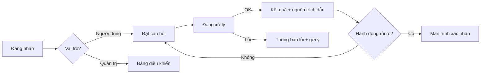

# Gate 1 — Chốt đề tài

> Hướng dẫn cho đội mới. Tổng hợp từ quy trình vận hành AI20K, sổ tay kỹ thuật,
> và những gì các đội Cohort 1–2 đã làm sai ở đúng giai đoạn này.

## G1 là gì

G1 là cổng đầu tiên trong 6 tuần. Mục đích: **chốt bài toán và thiết kế trước khi
viết logic**. Đội xác định xong đề, người dùng mục tiêu, và dựng khung repo.

| | |
|---|---|
| Thời điểm | Cuối tuần 2 (Cohort 3: hạn nộp 23:59 · 02/08) |
| Coach chấm | Trong 7 ngày sau hạn nộp (Cohort 3: 23:59 · 09/08) |
| Kết quả | Pass / Fail — hệ thống tự cấp **+100 XP mỗi thành viên** khi pass |
| Nộp ở đâu | Link minh chứng trong repo `P-XXX`, báo trên channel Discord `T-XXX` |

**4 deliverables bắt buộc:**

1. 1-page brief
2. PRD
3. Wireframe / UI Flow
4. GitHub repo + AI Log setup

Cohort 3 pass 10/10 đội. G1 không phải cổng khó — nhưng đội làm qua loa ở đây sẽ
trả giá ở G2 và Demo Day, vì ba tài liệu này là thứ giám khảo đọc để chấm **A1
(Problem–Solution fit)** và **A2 (Tư duy sản phẩm)**, hai trong sáu tiêu chí.

---

## 1 · 1-page brief

Một trang. Không hai trang. Đây là bài kiểm tra xem đội có hiểu đề không — nếu
không gói được vào một trang, tức là đội chưa chốt được bài toán.

```markdown
# <Tên sản phẩm> — Brief

**Mã đề:** AI20K-0XX   **Đội:** P-XXX   **Ngày:** dd/mm/yyyy

## Bài toán
Ai đang gặp vấn đề gì, trong tình huống nào, và hiện tại họ xử lý ra sao.
2–3 câu. Nói về người, không nói về công nghệ.

## Người dùng mục tiêu
Vai trò 1: <ai> — cần gì, đo bằng gì
Vai trò 2: <ai> — cần gì, đo bằng gì

## Giải pháp
Sản phẩm làm gì, trong một câu. Rồi 3–5 gạch đầu dòng về cách nó làm.

## Vì sao cần AI
Phần nào bắt buộc phải có LLM/agent, phần nào chỉ là phần mềm thường.
Nếu không trả lời được câu này, đề đang sai hướng.

## Không làm (Non-goals)
3–5 gạch đầu dòng. Thứ đội cố tình không làm trong 6 tuần.

## Đo thành công bằng gì
2–3 chỉ số cụ thể, có con số.
```

**Hai mục hay bị bỏ và đều mất điểm A1:**

- **Vì sao cần AI** — Cohort 1 có đội làm ra sản phẩm mà bỏ LLM đi vẫn chạy được.
  Giám khảo hỏi đúng câu đó ở phần Q&A.
- **Non-goals** — đội không viết phần này gần như luôn bị phình scope ở tuần 4,
  rồi không kịp deploy ở tuần 5.

> Yêu cầu sản phẩm tối thiểu của chương trình bắt buộc có **ít nhất 2 vai trò
> người dùng**. Nếu brief chỉ mô tả được một vai trò, đề chưa đạt — sửa ngay ở
> G1, đừng đợi đến lúc làm UI.

---

## 2 · PRD

PRD là brief được mở ra thành thứ có thể code theo. Không cần dài; cần **khớp
với code**.

```markdown
# PRD — <Tên sản phẩm>

## 1. Bối cảnh & Mục tiêu
Copy từ brief, mở rộng bối cảnh.

## 2. User personas
| Vai trò | Mô tả | Mục tiêu chính | Quyền hạn |
|---|---|---|---|

## 3. User stories
Là <vai trò>, tôi muốn <hành động>, để <kết quả>.
Ưu tiên: P0 (bắt buộc cho MVP) / P1 / P2.

## 4. Luồng chính (happy path)
Đánh số từng bước, từ lúc user mở app đến lúc nhận kết quả.

## 5. Human-in-the-loop
Hành động nào là rủi ro (gửi mail, ghi DB, thanh toán, xoá dữ liệu)?
Với mỗi hành động: user xác nhận ở bước nào, thấy thông tin gì trước khi bấm.

## 6. Xử lý lỗi & giới hạn
Agent không trả lời được thì hiện gì. Hết quota thì sao. LLM trả sai định dạng
thì sao. Hệ thống KHÔNG làm được gì — nói thẳng với user.

## 7. Dữ liệu
Nguồn dữ liệu, định dạng, cách lấy. Chỉ được dùng dữ liệu công khai, mô phỏng
hoặc đã ẩn danh.

## 8. Tech stack (dự kiến)
Ngôn ngữ, framework, LLM provider, vector store, nơi deploy.

## 9. Known Ambiguities
Những thứ đội chưa chốt được, và dự định chốt khi nào.
```

**Mục 5, 6 và 9 là ba mục phân biệt PRD tốt với PRD làm cho có.**

Mục 5 và 6 nằm thẳng trong yêu cầu sản phẩm tối thiểu của chương trình và quay
lại nguyên vẹn ở phiếu chấm Demo Day (B1, B3). Cohort 1 có 11/12 đội chỉ chặn
hành vi rủi ro bằng prompt, không có guardrail trong code — thiết kế sai từ PRD.

Mục 9 sinh ra từ một lỗi rất cụ thể của Cohort 1–2: **9/12 đội để PRD stale mà
không đánh dấu**. PRD ghi Node/Gemini nhưng code đã chuyển sang FastAPI/OpenAI.
Hậu quả không chỉ là tài liệu sai — AI coding agent đọc PRD, tin PRD, rồi sinh
code sai stack. Khi đội đổi hướng, sửa PRD trong cùng PR với code.

> PRD không phải tài liệu nộp một lần rồi quên. Nó là context mà agent của đội
> đọc mỗi ngày. PRD sai = code sai.

---

## 3 · Wireframe / UI Flow

Không cần đẹp. Cần **đủ màn hình** và **đúng luồng**. Vẽ tay chụp ảnh cũng được;
Figma, Excalidraw, hoặc Mermaid trong `/docs/` đều chấp nhận.

Tối thiểu phải có:

| # | Màn hình | Vì sao bắt buộc |
|---|---|---|
| 1 | Màn hình chính của **vai trò 1** | Yêu cầu tối thiểu: ≥ 2 vai trò |
| 2 | Màn hình chính của **vai trò 2** | Thiếu vai trò thứ hai là fail điều kiện sản phẩm |
| 3 | Màn hình **xác nhận** cho hành động rủi ro | Human-in-the-loop, chấm ở B1 và B3 |
| 4 | Trạng thái **đang xử lý** | Agent chạy 5–20 giây; không có state này, user tưởng app treo |
| 5 | Trạng thái **lỗi / không trả lời được** | "Xử lý lỗi và cảnh báo rõ giới hạn" — yêu cầu bắt buộc |
| 6 | Trạng thái **rỗng** (chưa có dữ liệu) | Màn hình đầu tiên user thấy; ảnh hưởng trực tiếp B3 |

Kèm một **UI Flow** — sơ đồ mũi tên nối các màn hình, ghi rõ điều kiện chuyển.
Viết bằng Mermaid để render thẳng trên GitHub:



Bốn màn hình trạng thái (3–6) là chỗ Cohort 1 mất điểm B3 nhiều nhất: đội chỉ vẽ
happy path, đến tuần 5 mới phát hiện chưa thiết kế gì cho lúc agent trả lời sai.

---

## 4 · GitHub repo + AI Log setup

Repo `P-XXX` đã được hệ thống tạo sẵn, có sẵn khung thư mục, Dockerfile, CI và
hook AI log. Chi tiết ở [Chương 2 — Khởi tạo dự án](chapter-02-khoi-tao-du-an.md).

7 mục cần xong trước G1:

- [ ] Repo đã clone, `git remote -v` trỏ đúng org `AI20K-Build-Phase-Cohort-3`
- [ ] Virtual environment và dependencies đã cài
- [ ] `.env` đã có API key thật (và **không** được commit)
- [ ] Server chạy được localhost, Swagger UI mở được
- [ ] README đã thay placeholder: mô tả, thành viên + vai trò, quick start
- [ ] Branch `develop` đã tạo, có ít nhất 1 commit
- [ ] AI Logging hooks đã cài (`setup_hooks.sh`), log đã lên grading server

> Lỗi 404 khi clone gần như luôn là **chưa accept invite vào organization**,
> không phải repo chưa tạo. Và đừng `rm -rf .git` rồi `git init` lại — remote đã
> trỏ đúng sẵn.

> Đừng vội viết agent logic. Repo có placeholder trong `src/agent/` — để yên cho
> đến khi xong thiết kế kiến trúc ở Chương 3.

---

## Pull Request — bắt đầu từ tuần 1, không phải tuần 5

G1 không chấm số lượng PR. **G2 thì có: repo phải có ≥ 10 PR đã merge.** Đây là
điều kiện bị bỏ sót nhiều nhất, và không thể làm bù — không ai merge được 10 PR
có nghĩa trong đêm trước hạn.

Vì vậy đội phải làm việc theo nhánh và pull request **ngay từ những commit đầu
tiên của G1**. Bốn tài liệu ở trên cũng đi qua PR, không push thẳng.

### Branching

- `main` — luôn deploy được. **Không bao giờ push trực tiếp.**
- `develop` — nhánh tích hợp, feature branch merge vào đây trước.
- `feature/<tên>` — mỗi tính năng hoặc fix một nhánh riêng.

```bash
git checkout develop
git pull origin develop
git checkout -b feature/prd-va-wireframe

git add docs/prd.md docs/ui-flow.md
git commit -m "docs: thêm PRD và UI flow cho G1"

git push origin feature/prd-va-wireframe
# Tạo PR trên GitHub: feature/prd-va-wireframe → develop
```

### Commit message

```
type(scope): mô tả ngắn gọn
```

`feat` · `fix` · `docs` · `test` · `refactor` · `chore`.
Scope gợi ý: `agent`, `api`, `config`, `models`, `tests`.

### 5 quy tắc PR

1. Tiêu đề theo format commit message
2. Mô tả: **thay đổi gì, tại sao, cách test**
3. Nhỏ và tập trung — một PR giải quyết một vấn đề
4. **Ít nhất 1 thành viên khác review** trước khi merge
5. Pass toàn bộ automated check (tests, lint) — repo đã có sẵn CI

```markdown
### Thay đổi
- Thêm tool tìm kiếm web cho Agent

### Tại sao
Agent cần thông tin real-time.

### Cách test
1. Set `TAVILY_API_KEY` trong `.env`
2. `pytest tests/unit/test_search_tool.py -v`

### Checklist
- [ ] Không có hardcoded secret
- [ ] Đã viết unit test
- [ ] Tests pass
```

### Vì sao quy tắc 4 quan trọng hơn vẻ ngoài của nó

PR có review là bằng chứng duy nhất cho thấy **nhiều người thật sự làm việc**.
Giám khảo đọc lịch sử commit để chấm B4. Một repo mà 90% commit đến từ một
người, hoặc toàn commit "update" lúc 2 giờ sáng ngày cuối, sẽ bị nhìn thấy.

Ngoài ra AI log gắn mỗi prompt với `branch` và `commit` — nên nhánh đặt tên tử tế
làm cho lịch sử làm việc của đội đọc được, thay vì một đống `feature/test2`.

---

## Bài học từ các khóa trước — tránh ngay ở G1

| Lỗi | Tỷ lệ Cohort 1 | Gốc rễ nằm ở G1 |
|---|---|---|
| Không có CI/CD | 12/12 đội | Repo đã có sẵn `.github/workflows/ci.yml` — chỉ cần push là chạy |
| Không có tests | 10/12 đội | Repo đã có sẵn khung test; PRD không định nghĩa acceptance criteria nên không biết test gì |
| Guardrail một lớp | 11/12 đội | PRD thiếu mục Human-in-the-loop và xử lý lỗi |
| PRD/docs stale không flag | 9/12 đội | Không có mục Known Ambiguities; không sửa doc cùng PR với code |
| Không có citation contract | 9/12 đội | PRD không quy định output phải kèm nguồn |
| README kém | 6/12 đội | Không cập nhật README ngay ở tuần 1, để đến nước rút |
| Thiếu architecture diagram | 5/12 đội | UI Flow ở G1 là bản nháp đầu tiên của nó — đừng vẽ lại từ đầu ở G2 |
| Hardcoded secret | 1/12 đội | `.env` bị commit trong tuần đầu |

> Nếu `.env` lỡ bị commit: (1) đổi API key trên dashboard provider **ngay**,
> (2) xoá khỏi git history bằng BFG Repo-Cleaner. Đổi key trước, dọn history sau.

---

## Checklist nộp G1

- [ ] `docs/brief.md` — đúng một trang, có mục "Vì sao cần AI" và "Non-goals"
- [ ] `docs/prd.md` — có đủ mục 5 (HITL), 6 (lỗi & giới hạn), 9 (Known Ambiguities)
- [ ] `docs/ui-flow.md` — ≥ 6 màn hình, có sơ đồ Mermaid, đủ 2 vai trò
- [ ] Repo clone được, server chạy được, `.env` **không** nằm trong git
- [ ] README đã thay placeholder
- [ ] Branch `develop` tồn tại; các tài liệu trên vào repo **qua PR đã merge**
- [ ] AI log hook đã cài và đã có log lên server
- [ ] Đã báo link minh chứng trên channel `T-XXX` trước 23:59 hạn nộp

Coach có 7 ngày để chấm. Nộp sớm thì còn kịp sửa nếu fail — nộp đúng 23:59 thì
không.
