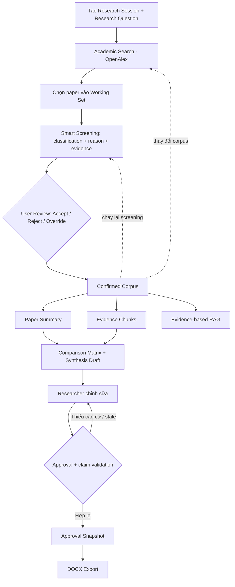

# PRD — LitReview Agent

| Hạng mục | Nội dung |
|---|---|
| Mã dự án / đội | EDU-09 / P-107 |
| Phiên bản | 1.1 — Gate 1 |
| Trạng thái | MVP 5 tuần, đang chốt thiết kế |
| Brief liên quan | [`docs/brief.md`](brief.md) |

## 1. Bối cảnh & Mục tiêu

Literature review hiện phân tán giữa tìm kiếm học thuật, ghi chú, công cụ
citation và trình soạn thảo. LitReview Agent cung cấp một workflow thống nhất
để tìm kiếm, sàng lọc, tóm tắt, hỏi đáp có evidence và tạo bản nháp review.
Mục tiêu MVP là demo được workflow end-to-end với tối đa 50 bài/session,
nguồn OpenAlex, metadata/abstract và một citation style APA 7.

## 2. User personas

| Vai trò | Mô tả | Mục tiêu chính | Quyền hạn |
|---|---|---|---|
| Researcher | Sinh viên, học viên cao học hoặc nhà nghiên cứu | Tạo corpus và bản nháp có thể kiểm chứng | Tìm kiếm, review/override, hỏi đáp, chỉnh sửa, yêu cầu tạo draft và phê duyệt |
| Reviewer | Giảng viên hướng dẫn hoặc người kiểm tra | Đánh giá citation, evidence và nội dung trước khi xuất | Xem, bình luận/chỉnh sửa, yêu cầu sửa, phê duyệt hoặc từ chối export |

## 3. User stories

| ID | User story | Ưu tiên |
|---|---|---|
| US-01 | Là Researcher, tôi muốn nhập research question và tìm bài báo từ OpenAlex để tạo working set. | P0 |
| US-02 | Là Researcher, tôi muốn xem lý do AI phân loại và accept/reject/override từng bài để kiểm soát corpus. | P0 |
| US-03 | Là Researcher, tôi muốn tạo summary 5 trường và thấy provenance/thiếu dữ liệu để không nhầm AI đã đọc full text. | P0 |
| US-04 | Là Researcher, tôi muốn hỏi trên Confirmed Corpus và nhận citation/evidence hoặc thông báo chưa đủ căn cứ. | P0 |
| US-05 | Là Researcher, tôi muốn tạo comparison matrix và review draft có citation để chỉnh sửa. | P0 |
| US-06 | Là Reviewer, tôi muốn xem và phê duyệt draft hiện tại trước khi export DOCX. | P0 |
| US-07 | Là người dùng, tôi muốn thấy trạng thái loading, lỗi và dữ liệu rỗng để biết app đang làm gì. | P0 |
| US-08 | Là người dùng, tôi muốn bổ sung full-text PDF, nhiều nguồn tìm kiếm và citation style khác. | P2 — future |

## 4. Luồng chính (happy path)

1. Researcher mở app, tạo session và nhập research question.
2. Hệ thống tìm metadata/abstract từ OpenAlex; Researcher chọn bài vào working set.
3. Agent phân loại mức độ liên quan và hiển thị lý do/evidence.
4. Researcher accept, reject hoặc override; chỉ bài được xác nhận mới vào corpus.
5. Researcher yêu cầu summary, hỏi đáp hoặc tạo matrix/draft từ corpus.
6. Hệ thống hiển thị kết quả kèm citation và evidence; thiếu căn cứ thì abstain.
7. Researcher chỉnh sửa draft và gửi Reviewer kiểm tra.
8. Reviewer phê duyệt; hệ thống kiểm tra artifact không stale rồi mới cho export DOCX.

## 5. Human-in-the-loop

| Hành động rủi ro | Xác nhận | Thông tin phải thấy trước khi bấm |
|---|---|---|
| Đưa paper vào Confirmed Corpus | Researcher accept/override từng paper | Phân loại AI, lý do, abstract/metadata và lựa chọn cuối |
| Dùng kết quả AI trong draft | Researcher chỉnh sửa/ghi đè nội dung | Claim, citation, evidence, nguồn và trường thiếu dữ liệu |
| Phê duyệt draft | Researcher hoặc Reviewer bấm Approve | Phiên bản, corpus version, cảnh báo claim chưa valid/stale |
| Xuất DOCX | Chỉ cho phép sau approval hiện hành | Snapshot nội dung được duyệt, citation và hash export |

Không gửi mail, thanh toán hay xoá dữ liệu trong MVP. Guardrail phải nằm trong
API/domain validation, không chỉ trong prompt.

## 6. Xử lý lỗi & giới hạn

- Agent lỗi, timeout hoặc trả sai schema: retry có giới hạn; nếu vẫn lỗi, hiện
  trạng thái thất bại và cho phép thử lại, không lưu kết quả chưa hợp lệ.
- Không đủ evidence: trả `insufficient_evidence` hoặc `no_matching_evidence`,
  nêu rõ phạm vi corpus; không suy diễn và không tạo citation.
- Hết quota/API lỗi: hiện thông báo thân thiện, giữ dữ liệu/session và cho retry.
- Corpus/draft thay đổi: tăng `corpus_version`, đánh dấu draft/approval stale và
  chặn export cho đến khi tạo/kiểm tra lại.
- Abstract không có trường cần thiết: hiển thị “Không đề cập trong nguồn hiện có”.
- MVP không làm full-text PDF, thống kê, plagiarism check, cộng tác phức tạp,
  nhiều nguồn tìm kiếm hoặc cam kết chính xác tuyệt đối.

## 7. Dữ liệu

- Nguồn công khai duy nhất: OpenAlex API.
- Dữ liệu lưu: OpenAlex ID/DOI, title, authors, year, venue, abstract và source
  type (`metadata_only` hoặc `abstract`); evidence giữ nguyên đoạn nguồn.
- Dữ liệu mô phỏng được dùng cho test/eval; không dùng dữ liệu cá nhân hoặc tài
  liệu có quyền truy cập hạn chế.
- Session tối đa 50 paper; SQLite và chunk store trong database cho MVP.

## 8. Tech stack (dự kiến)

- Python 3.11, FastAPI/Uvicorn, Pydantic, SQLite.
- LangGraph/LangChain cho một workflow agent; OpenRouter qua API tương thích
  OpenAI cho LLM (provider được cấu hình bằng `LLM_PROVIDER`).
- Frontend Next.js hoặc Streamlit (chưa chốt — xem mục 9).
- pytest + ruff; Docker + GitHub Actions; deploy backend trên nền tảng phù hợp.
- MVP không cần vector store: evidence chunk được lưu/truy xuất trong database.

## 9. Known Ambiguities

| Vấn đề chưa chốt | Cách chốt | Hạn chốt |
|---|---|---|
| Chọn Next.js hay Streamlit | Spike UX và thống nhất với người phụ trách frontend | Cuối tuần 1 |
| Nền tảng deploy cuối cùng | So sánh quota, HTTPS và thời gian cấu hình | Cuối tuần 2 |
| Cách reviewer truy cập session | Prototype permission/session sharing tối thiểu | Cuối tuần 2 |
| Bộ dữ liệu đánh giá screening | Gán nhãn mẫu công khai và thống nhất rubric | Cuối tuần 2 |
| Thành viên và ownership chi tiết | Cập nhật sau buổi phân công; sửa PRD cùng PR code liên quan | Trước bắt đầu tuần 1 |

Khi code đổi stack hoặc phạm vi, phải cập nhật mục này và PRD trong cùng PR;
code và test là source of truth kỹ thuật.

## 10. Nguyên tắc sản phẩm và phạm vi MVP

### 10.1. Nguyên tắc bất biến

- **Human-in-the-loop:** AI chỉ đề xuất; Researcher/Reviewer quyết định paper
  vào corpus, chỉnh sửa nội dung và phê duyệt bản nháp.
- **Evidence-based:** claim do AI tạo phải truy xuất được qua chuỗi
  `Claim → Citation → Evidence Chunk → Paper → Source`.
- **Không bịa:** không tạo citation, DOI, finding, methodology hoặc dataset
  không có trong dữ liệu nguồn.
- **Minh bạch nguồn:** metadata và abstract được phân biệt; không tuyên bố đã
  đọc full text khi hệ thống chỉ có abstract.
- **Một workflow:** MVP dùng một LangGraph workflow nhiều node, không dùng
  multi-agent.
- **Scope khả thi:** MVP tập trung vào một chủ đề, tối đa 50 paper/session,
  một LLM provider và APA 7.

### 10.2. Phân loại scope

| Mức | Hạng mục |
|---|---|
| Must | OpenAlex Search, Working Set, Smart Screening có quyết định người dùng, Confirmed Corpus, Summary có provenance, Evidence-based RAG, Comparison Matrix, Synthesis Draft, claim validation, Approval gate, DOCX export, session persistence, citation/evidence traceability |
| Should | Phân trang search, lịch sử phiên bản draft, rename/delete session |
| Could | Template DOCX bổ sung, xuất riêng matrix, cache RAG response |
| Out of scope | Full-text PDF, thống kê, plagiarism check, nhiều nguồn search, cộng tác phức tạp, vector database riêng, multi-agent |

### 10.3. Giới hạn đầu vào LLM

- Screening: tối đa 300 từ/abstract, batch mặc định 10 paper.
- Summarization: tối đa 2.000 từ/abstract.
- Abstract gốc luôn lưu nguyên vẹn. Nếu cần rút gọn, hệ thống phải lưu giới
  hạn, phần thực tế gửi, tác vụ và trạng thái `truncated`, đồng thời báo rõ trên UI.
- Không được cắt âm thầm hoặc ghi đè abstract gốc.

## 11. Workflow và functional requirements

### 11.1. Workflow tổng thể

RAG là chức năng độc lập, không phải điều kiện tiên quyết của Generator.
Summary, RAG và Generator chỉ dùng Confirmed Corpus hiện hành. Khi membership
corpus thay đổi, `corpus_version` tăng, draft/approval cũ stale và phải rebuild.

### 11.2. Functional requirements

| Nhóm | Requirement bắt buộc |
|---|---|
| Search | Query tự do trả title, authors, year, venue, DOI, OpenAlex ID và abstract hoặc `Abstract not available`; paper trùng OpenAlex ID/DOI chuẩn hóa không được thêm hai lần; lỗi/timeout có retry; `source_type` chỉ là `metadata_only` hoặc `abstract`. |
| Screening | AI trả `Relevant`, `Partially Relevant`, `Not Relevant` hoặc `Insufficient Evidence` cùng reason và evidence; tách `classification_status` khỏi `review_status`; output schema phải validate và retry tối đa một lần; lỗi kỹ thuật không được biến thành nhãn nghiệp vụ. |
| Review | Accept/Reject/Override do người dùng quyết định; AI classification không bị ghi đè; Confirmed Corpus chỉ gồm Accepted/Overridden với final classification Relevant/Partially Relevant; không tự động xóa paper. |
| Summary | Tạo 5 trường Research Objective, Methodology, Dataset, Results, Limitations; mỗi trường có provenance; thiếu dữ liệu ghi `Không đề cập trong nguồn hiện có`; cho phép sửa từng trường và giữ provenance gốc. |
| RAG | Response có `answer`, `answer_status`, `citations`, `evidence`; status là `sufficient_evidence`, `insufficient_evidence` hoặc `no_matching_evidence`; evidence là trích nguyên văn từ abstract, có Chunk ID/Paper ID; câu hỏi ngoài corpus phải abstain. |
| Generator | Matrix có một dòng mỗi paper, kể cả chưa có Summary; Synthesis chỉ dùng Summary/Evidence của corpus hiện hành; factual/synthesis/interpretation claim được gắn nhãn và citation/evidence phù hợp; không lấy RAG answer làm input bắt buộc. |
| Approval/Export | Mọi claim trong bản duyệt phải `validation_status=valid` và `support_status=supported`; Approval Snapshot bất biến; DOCX chỉ sinh từ snapshot hợp lệ, không gọi LLM lúc export; thay đổi draft/corpus/input phải invalidate approval. |
| Session | Mọi Paper, Citation, Evidence và Draft thuộc đúng `session_id`; session restore được sau restart; paper trùng ID/DOI chỉ có một entry trong session. |

### 11.3. Trạng thái nghiệp vụ và thực thi

`review_status`: `Pending Review`, `Accepted`, `Rejected`, `Overridden`.

`classification_status` và `summary_status`: `pending`, `processing`,
`completed`, `failed`, `timeout`.

`answer_status`: `sufficient_evidence`, `insufficient_evidence`,
`no_matching_evidence`.

`draft.status`: `Draft`, `Pending Review`, `Approved`, `Stale`;
`approval.status`: `Active` hoặc `Invalidated`.

## 12. Acceptance criteria

| ID | Kịch bản | Tiêu chí đạt |
|---|---|---|
| AC-01 | Search | Kết quả có đủ metadata/source type; lỗi OpenAlex có retry; không trùng paper trong session. |
| AC-02 | Working Set | Paper được gắn đúng session và không xuất hiện ở session khác. |
| AC-03 | Screening | Classification hợp lệ có reason/evidence; lỗi schema retry một lần; lỗi kỹ thuật giữ trạng thái failed/timeout và không cho Accept/Override. |
| AC-04 | Review | Accept/Reject/Override cập nhật đúng final classification; AI label vẫn giữ nguyên; chỉ paper đủ điều kiện vào Confirmed Corpus. |
| AC-05 | Summary | Có đủ 5 trường, provenance từng trường, nhãn thiếu dữ liệu và cho sửa từng trường. |
| AC-06 | RAG | Câu trả lời mới chỉ dùng corpus hiện hành; evidence nguyên văn và citation resolve được; thiếu evidence thì không tạo kết luận/citation giả. |
| AC-07 | Generator | Matrix đủ paper; synthesis có claim/citation/evidence; không cần hỏi RAG trước; claim thiếu căn cứ bị gắn unsupported hoặc loại khỏi draft. |
| AC-08 | Approval/Export | Không thể approve draft stale hoặc claim chưa valid; DOCX khớp Approval Snapshot và có Export Record/hash riêng. |
| AC-09 | Session | Reload/restart không mất dữ liệu; mọi thao tác cross-session bị từ chối. |
| AC-10 | Giới hạn | UI phân biệt processing, empty, timeout, quota, schema error và insufficient evidence; không tuyên bố hệ thống đã đọc PDF/full text. |

Mỗi acceptance criterion phải có ít nhất một unit test hoặc integration/smoke
test tương ứng. LLM và OpenAlex phải mock được để test chạy không cần API key.

## 13. Non-functional requirements

### 13.1. Hiệu năng mục tiêu

| Tác vụ | Target p90 | Điều kiện đo |
|---|---:|---|
| Academic Search | ≤ 5 giây | Query đơn, page size mặc định, OpenAlex bình thường |
| Screening | ≤ 20 giây | Batch 10 paper, abstract ≤300 từ |
| Summary | ≤ 20 giây/paper | Abstract ≤2.000 từ |
| RAG | ≤ 15 giây/câu hỏi | Corpus ≤30 paper |

Đây là target đánh giá, không phải kết quả đã đạt. Vượt target phải hiển thị
`processing`; hard timeout mặc định 60 giây và có retry.

### 13.2. Reliability, security và privacy

- Output có cấu trúc phải schema-validate; retry tối đa một lần trước khi báo lỗi.
- Thao tác lỗi không ghi đè dữ liệu đã lưu; Evidence Chunk bất biến sau khi tạo.
- API key chỉ đọc từ environment, không commit/log/trả về frontend.
- LLM chỉ nhận dữ liệu allowlist của đúng session và tác vụ; không gửi secret,
  session khác hoặc dữ liệu không liên quan.
- Mọi read/write/resolve Paper, Citation, Evidence Chunk kiểm tra cả
  `session_id`, không chỉ `paper_id`.
- Dữ liệu chỉ gồm metadata/abstract công khai, dữ liệu mô phỏng hoặc đã ẩn danh.

### 13.3. Usability và testability

- Mọi output AI hiển thị nguồn và phân biệt direct evidence với diễn giải.
- Nhãn processing, lỗi kỹ thuật, timeout, thiếu evidence và dữ liệu truncated
  phải khác nhau trên UI.
- Có unit test cho schema, state transition, session isolation và approval hash.
- Dataset đánh giá được version trong `eval/`; có integration test cho luồng
  Search → Screening → Corpus → Summary/RAG → Generator → Approval → Export.

## 14. Tech constraints và data model

### 14.1. Tech constraints

| Layer | Lựa chọn MVP |
|---|---|
| Backend | Python 3.11, FastAPI/Uvicorn, Pydantic |
| Agent | LangGraph/LangChain, một workflow nhiều node |
| LLM | OpenRouter qua API tương thích OpenAI, một provider; mock-first khi test |
| Source | OpenAlex, nguồn học thuật duy nhất |
| Database | SQLite |
| Retrieval | Evidence Chunk store trong database, không vector DB riêng |
| Export | `python-docx` hoặc tương đương, sinh từ Approval Snapshot |
| Quality | pytest, pytest-asyncio, ruff, Docker, GitHub Actions |
| Frontend/deploy | Next.js hoặc Streamlit; nền tảng deploy TBD ở mục 9 |

### 14.2. Entities chính

| Entity | Trường chính |
|---|---|
| Research Session | `session_id`, `research_question`, `corpus_version`, timestamps |
| Paper | `paper_id`, `session_id`, metadata, `abstract`, `source_type` |
| Screening Result | AI/final classification, review/execution status, reason, evidence, override note |
| Paper Summary | 5 fields, provenance, `user_edited`, source/status |
| Evidence Chunk | `chunk_id`, `session_id`, `paper_id`, source type, nguyên văn content, position, hash |
| Citation | `citation_id`, `session_id`, `paper_id`, optional `chunk_id`, active/historical |
| RAG Exchange | question, answer/status, citation/evidence IDs, snapshot, corpus version |
| Literature Review Draft | version, canonical content, matrix, claims, content hash, input fingerprint, corpus version, stale/status |
| Generated Claim | claim text/type/hash, citation/evidence IDs, support/validation status |
| Approval Snapshot | immutable content snapshot, approved hash/version, corpus version, status |
| Export Record | approval ID, filename, binary file hash, exported timestamp |

### 14.3. Invalidation và traceability

1. Corpus membership đổi → tăng `corpus_version`, draft stale, approval invalidate.
2. Summary/Evidence/Research Question hoặc generation config nằm trong input
   thực tế đổi → fingerprint lệch, artifact stale.
3. Claim text đổi → claim hash lệch, validation cũ stale và phải validate lại.
4. Paper bị loại khỏi corpus không dùng cho RAG/Generator mới; dữ liệu lịch sử
   vẫn giữ để xem nhưng không tái sử dụng làm evidence hiện hành.
5. Mỗi claim mới phải truy ra citation/evidence trong đúng session; citation
   chỉ có metadata dùng cho bibliography, không chứng minh findings.
6. DOCX canonical content gồm Research Question, Synthesis, Matrix, citations,
   References và mọi nội dung export; mỗi lần export tạo Export Record mới.

## 15. Evaluation metrics

Các số dưới đây là target, không phải kết quả thực nghiệm.

| Metric | Target | Cách đo |
|---|---:|---|
| Screening Macro-F1 | ≥ 0.80 | Ba lớp Relevant/Partially Relevant/Not Relevant so với human reference label; abstention/lỗi báo riêng |
| Citation Traceability | 100% | Citation resolve tới paper hợp lệ trong đúng session/corpus |
| Citation-Evidence Support | ≥ 80% | Tỷ lệ claim được người chấm xác nhận evidence hỗ trợ |
| Summary Faithfulness | ≥ 80% | Tỷ lệ trường summary phản ánh đúng nguồn |
| Structured Output Validity | ≥ 95% | Output cuối hợp lệ schema sau retry |
| End-to-End Task Completion | ≥ 80% | Kịch bản Search → DOCX sau Approval, gồm xử lý thiếu evidence |
| Time Reduction (stretch) | ≥ 50% | So với workflow thủ công, tính cả thời gian review |

Screening Macro-F1 không dùng `final_classification` làm nhãn tham chiếu; nhãn
tham chiếu do hai annotator gán và adjudicate khi bất đồng. `Insufficient
Evidence` là abstention, không phải lớp thứ tư. Nếu thiếu mẫu/lớp, báo metric
không đủ điều kiện thay vì gán 0 hoặc 1.

## 16. Milestones, risks và assumptions

### 16.1. Milestones 5 tuần

| Tuần | Trọng tâm | Exit criteria |
|---|---|---|
| 1 | Foundation, schema, API contract, OpenAlex Search, session | Tạo session, search chuẩn hóa, mock/test lỗi |
| 2 | Working Set, Screening, user review, Confirmed Corpus | Search → Corpus chạy được, test Accept/Reject/Override |
| 3 | Summary, provenance, persistence, Evidence Chunk, Generator smoke test | Summary sửa được, reload không mất dữ liệu, evidence truy xuất được |
| 4 | RAG, citation resolution, Matrix, Synthesis, claim validation prototype | RAG trả lời/abstain đúng; Generator không phụ thuộc RAG history |
| 5 | Approval, snapshot/hash, DOCX export, integration, evaluation, demo | Demo end-to-end; mọi Must FR có test và báo cáo giới hạn |

Testing bắt đầu từ tuần 1; tuần 5 chỉ tích hợp/regression, không mở tính năng mới.

### 16.2. Rủi ro và giảm thiểu

| Rủi ro | Giảm thiểu |
|---|---|
| OpenAlex/LLM downtime hoặc quota | Mock data, retry, timeout, giữ session và báo lỗi rõ |
| Hallucination/schema sai | Schema validation, retry, evidence contract, user review |
| Abstract thiếu độ sâu | Hiển thị source type và trường thiếu; không tuyên bố full text |
| Scope creep PDF/vector DB/multi-agent | Giữ non-goals, cắt Should trước, không mở feature tuần 5 |
| Tích hợp nghẽn giữa 4 người | Chốt API/data contract tuần 1, workstream rõ, smoke test hàng tuần |
| Draft stale hoặc cross-session leak | Input fingerprint, invalidation rules, kiểm tra session_id |

### 16.3. Assumptions và open questions

| ID | Câu hỏi/giả định | Cách xử lý | Hạn |
|---|---|---|---|
| A-01 | MVP single-user, không auth đầy đủ | Giữ session ID và chưa làm permission phức tạp | Trước tuần 1 |
| A-02 | Một LLM provider, mock khi test | Chốt provider và model | Cuối tuần 1 |
| A-03 | Một chủ đề và bộ dữ liệu screening | Hai annotator, adjudicate khi bất đồng | Cuối tuần 2 |
| A-04 | APA 7, một DOCX template | Product chốt trước Generator | Cuối tuần 2 |
| Q-01 | Next.js hay Streamlit | Spike UX rồi chốt với frontend owner | Cuối tuần 1 |
| Q-02 | Nền tảng deploy | So sánh quota/HTTPS/thời gian cấu hình | Cuối tuần 2 |
| Q-03 | Cơ chế Reviewer truy cập session | Prototype sharing tối thiểu hoặc giữ single-user | Cuối tuần 2 |
| Q-04 | Có user study Time Reduction không | Chỉ làm nếu còn thời gian; không phải điều kiện MVP | Tuần 5 |

Bộ dữ liệu đánh giá — nguồn, quy trình xây dựng, đặc tính: xem [docs/eval-dataset.md](eval-dataset.md).

Mọi quyết định làm thay đổi API contract, data model, stack hoặc scope phải cập
nhật mục 9 và mục này trong cùng PR với code.

