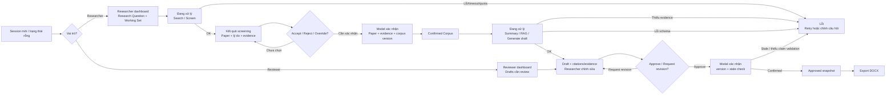

# LitReview Agent — Wireframe / UI Flow

Wireframe MVP được mô tả bằng các màn hình và trạng thái dưới đây. Đây là bản
đủ để implement UI; visual design có thể thay đổi sau usability check.

## Màn hình bắt buộc

### 1. Researcher — màn hình chính

- Nhập Research Question; nút `Search papers`.
- Danh sách Working Set với title, year, source type, abstract availability.
- CTA `Screen papers` và trạng thái corpus hiện tại.

### 2. Reviewer — màn hình chính

- Danh sách session/draft được chia sẻ.
- Bộ lọc `Needs review`, `Approved`, `Stale`.
- Xem claim, citation, evidence và nút `Request revision` / `Approve`.

### 3. Xác nhận hành động rủi ro

- Modal trước khi accept/override paper hoặc approve draft.
- Hiển thị thay đổi, nguồn/evidence, corpus version, cảnh báo stale và nút
  `Confirm` / `Cancel`.

### 4. Đang xử lý

- Progress step: searching → screening → summarizing/generating.
- Hiển thị tên tác vụ, thời gian ước tính và nút `Cancel/Back` nếu an toàn.
- Không cho người dùng tưởng app bị treo; giữ session id để refresh.

### 5. Lỗi / không trả lời được

- Nêu rõ loại lỗi: API/timeout, sai schema, không đủ evidence hoặc quota.
- Không hiển thị câu trả lời suy đoán; có `Retry`, `Edit question` hoặc `Back`.
- Nếu thiếu evidence, hiển thị phạm vi corpus đã kiểm tra.

### 6. Trạng thái rỗng

- Session mới: hướng dẫn nhập Research Question và ví dụ ngắn.
- Working Set rỗng: hướng dẫn Search; Confirmed Corpus rỗng: hướng dẫn review.
- Draft rỗng: giải thích cần corpus đã xác nhận trước khi Generate.

## UI Flow

## Điều kiện chuyển

| Từ → đến | Điều kiện |
|---|---|
| Empty → Researcher dashboard | Session được tạo hoặc khôi phục hợp lệ |
| Dashboard → Processing | Input hợp lệ và request được gửi |
| Processing → Results | Agent trả schema hợp lệ; lưu result/evidence |
| Results → Confirmed Corpus | Người dùng xác nhận quyết định và server validate session |
| Draft → Approval | Mọi claim hiện hành có validation/evidence hợp lệ |
| Approval → Export | Approval snapshot khớp corpus hiện tại, không stale |
| Bất kỳ processing → Error | Timeout, quota, upstream/API failure hoặc output không hợp lệ sau retry |

